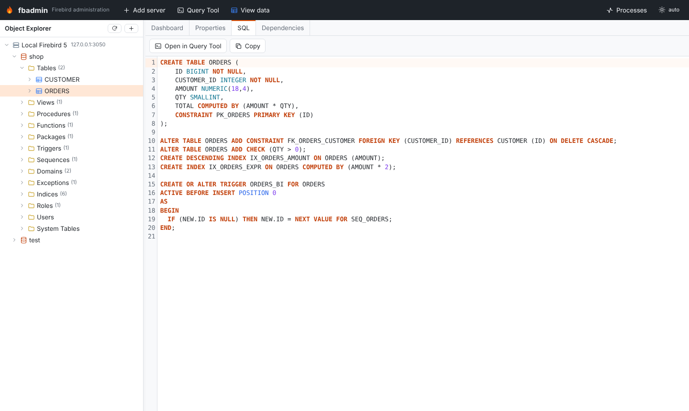
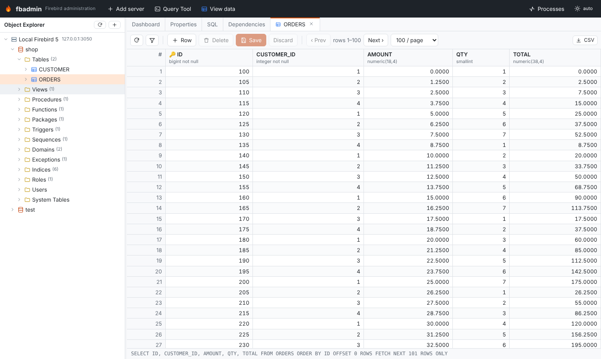
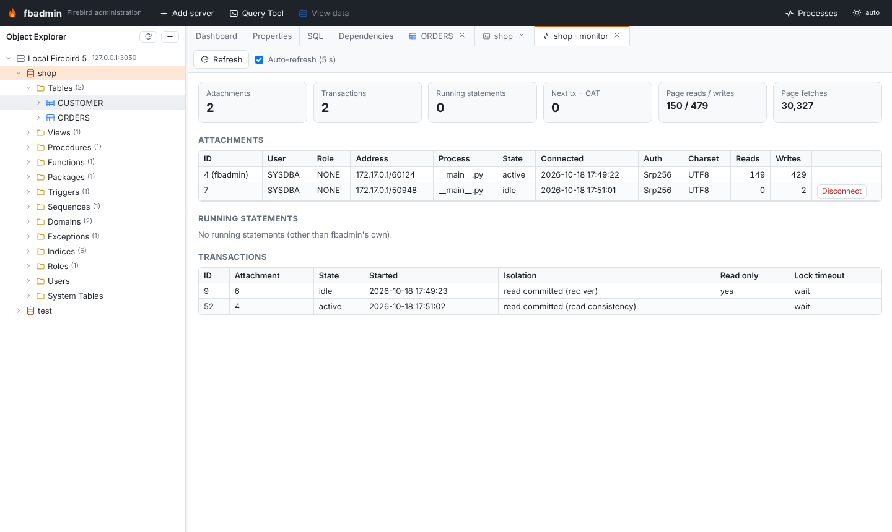
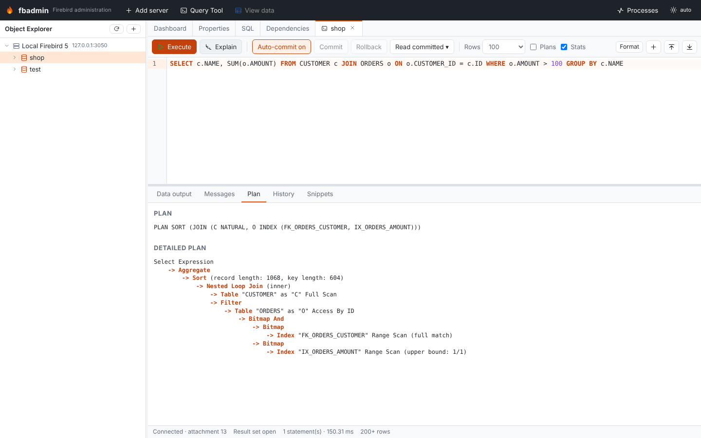
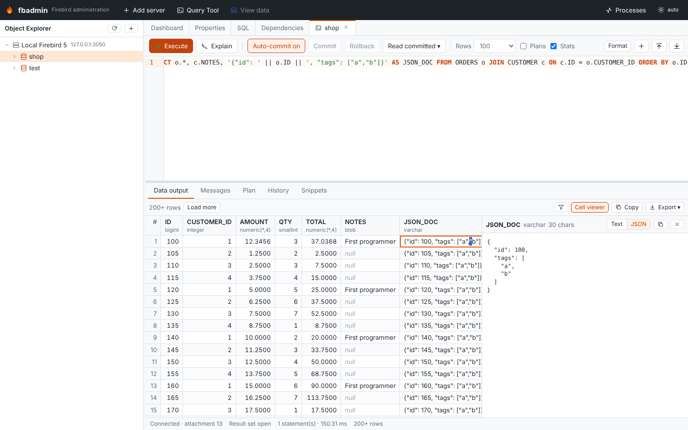
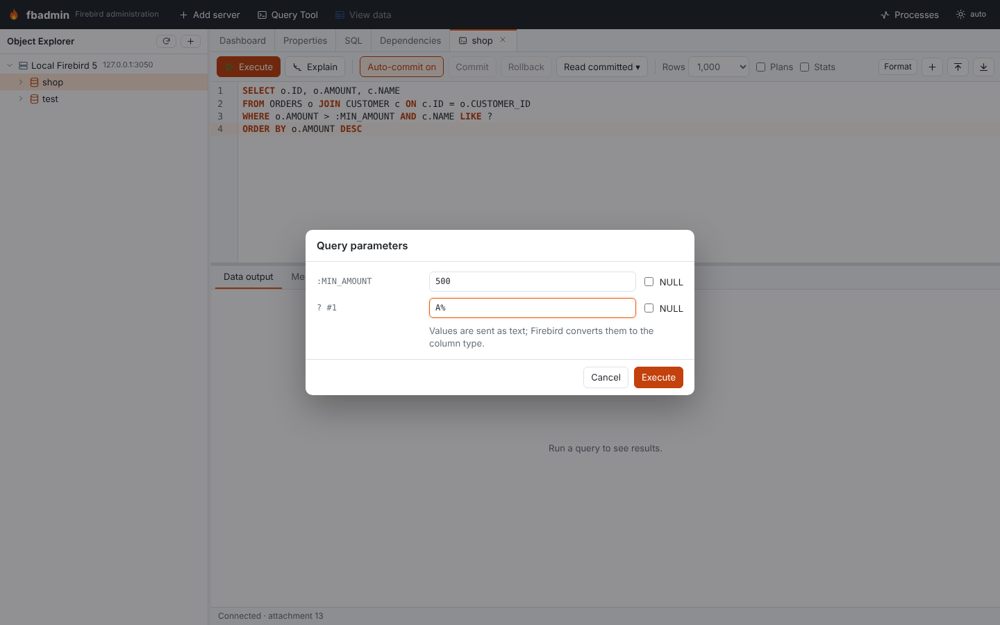
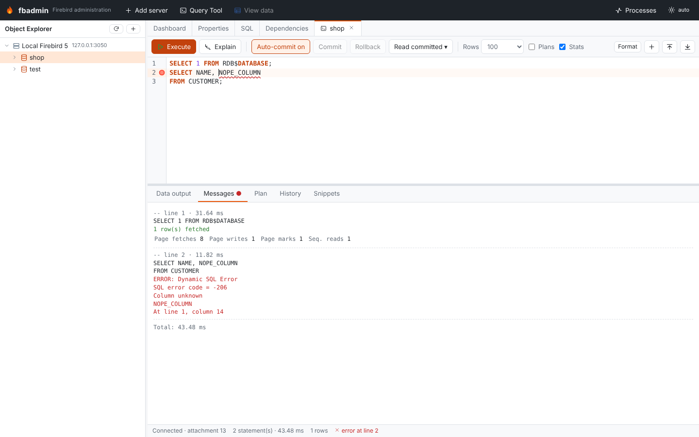

# fbadmin

**A pgAdmin-style web administration and development tool for [Firebird SQL](https://firebirdsql.org).**

fbadmin gives Firebird a modern, browser-based admin UI. It has an object explorer,
DDL extraction, a query tool with plans and transactions, an editable data grid, live
monitoring and backup/restore. It runs as a local app (like pgAdmin's desktop mode) or
as a container next to your server.


> **Status:** every milestone of the [ROADMAP](ROADMAP.md) up to 2.0 is implemented and
> verified in CI (Firebird 6.0 final support waits for its release):
> - Firebird **3.0, 4.0, 5.0 and the 6.0 snapshots**
> - real LDAP, OIDC and database-encryption services
> - a Kubernetes operator deployment
> - installers on Windows, macOS and Linux
>
> The UI speaks English, Romanian, Portuguese (Brazil), Spanish, Russian, German, French and
> Czech. Current release: **2.0.0**, on [PyPI](https://pypi.org/project/firebird-admin/) (`pip install firebird-admin`) and as desktop installers on the
> [GitHub Releases](https://github.com/mariuz/fbadmin/releases) page.

## Features

| Area | What it does |
|---|---|
| **Object Explorer** | Servers → databases → (Firebird 6: schemas →) tables, views, procedures, functions, packages, triggers, sequences, domains, exceptions, indices, roles, users, system tables, collations, shadows and BLOB filters. Objects load lazily, and every node has a context menu. |
| **Object dialogs** | pgAdmin-style create/alter dialogs with SQL preview: a table designer (columns, constraints, indices, triggers), columns, constraints, indices (partial, expression), views, sequences, domains, exceptions and roles. A PSQL editor maps compile errors to lines. Also a grants editor, comments, renames, and drop with a preview of what depends on the object. |
| **SQL (DDL)** | Re-creatable DDL for every object, and a full database extract (like `isql -x`) ordered by dependencies. Round-trip tests run on every CI run. |
| **Query Tool** | CodeMirror editor with column-aware autocompletion, minimap, macros and configurable shortcuts. Splits scripts with `SET TERM`. Cancel, parameter prompts, detailed plans with a plan diagram and plan diff, I/O and record stats per statement, and transaction settings. Export results to CSV, TSV, JSON, SQL, Markdown or XLSX, **chart them**, and keep a **shared query library**. Optional AI assistant (opt-in). |
| **Data grid** | Paged, sorted and filtered table data. In-grid edits are saved in one transaction. BLOB viewer and upload. Resizable and frozen columns. |
| **Schema tools** | Schema diff with a migration script (database ↔ database or DDL script), ERD viewer and designer with SVG/PNG export, a visual query builder, import/export wizard (CSV, JSON, XLSX), copy data between databases, **data compare** with a sync script, **schema history in git**, an **upgrade assistant** for Firebird 4, 5 and 6, object search, test data generator, and a report of unused or invalid objects. |
| **Monitoring** | A **multi-server overview**, live dashboard charts, table statistics, compiled statement cache, OIT/OAT alerts, lock waits, history in SQLite, **alerts by email, Slack or webhook**, an **event monitor** for `POST_EVENT`, the Firebird 5 profiler with a PSQL hot-spot tree, **PSQL trace runs and test cases**, an index advisor, and a Prometheus `/metrics` exporter. |
| **Maintenance** | Backup and restore streamed through the browser, nbackup, validate/mend/sweep/limbo transactions, shutdown and online, database properties, gstat charts, the Trace API with live streaming, encryption, scheduled jobs with **test restores** and **uploads to S3, Azure Blob Storage or Google Cloud Storage**, and `RDB$CONFIG`. |
| **Replication** | Publications and published tables, replica mode, lag between primary and replica, journal tracking, and a `replication.conf` helper (Firebird 4+). |
| **Security** | Server mode with logins, **two-factor sign-in (TOTP)**, **API tokens**, **per-database and per-object permissions**, CSRF protection, a master password (Argon2id + AES-GCM), LDAP/OIDC/proxy-header authentication, per-user and shared servers, an audit log, read-only servers, wire encryption and compression, Firebird users, mappings and system privileges. |
| **Deployment** | pip, Docker (multi-arch), a Helm chart, a Kubernetes example, servers preconfigured from a file and Secrets, a **command-line tool** (`fbadmin backup`, `restore`, `extract`, `diff`, `sql`, `check`), and desktop builds (MSI, dmg, AppImage, deb, rpm, Flatpak) with verified self-update and a bundled **embedded engine for local `.fdb` files**. |
| **UI** | Light, dark and high-contrast themes, 8 languages, a **phone and tablet layout**, keyboard navigation and ARIA (audited with axe-core in CI), and a plugin API for tree nodes, menus, tabs and dashboard panels. No telemetry. |

<table>
<tr><td></td><td></td></tr>
<tr><td></td><td></td></tr>
<tr><td></td><td></td></tr>
<tr><td></td><td></td></tr>
</table>

## Quick start

### With Docker Compose (includes a Firebird 5 server)

```bash
docker compose up --build
# open http://localhost:5050
# Add server → host "firebird", user SYSDBA, password "masterkey",
# first database: /var/lib/firebird/data/demo.fdb
```

### From source

Requirements: Python 3.10+ and Node 18+. You do **not** need a Firebird client library:
fbadmin uses the pure-Python [`firebirdsql`](https://github.com/nakagami/pyfirebirdsql) driver.

```bash
git clone https://github.com/mariuz/fbadmin && cd fbadmin
python -m venv .venv && . .venv/bin/activate
pip install -e "backend[dev]"
(cd frontend && npm install && npm run build)   # builds the UI into backend/fbadmin/static
fbadmin                                          # opens http://localhost:5050
```

Command-line options: `fbadmin --host 0.0.0.0 --port 5050 --no-browser`.

| Environment variable | Default | Meaning |
|---|---|---|
| `FBADMIN_DATA_DIR` | `~/.fbadmin` | Where `servers.json` (registered servers) is stored, with mode 0600 |
| `FBADMIN_HOST` / `FBADMIN_PORT` | `127.0.0.1` / `5050` | Bind address |
| `FBADMIN_MAX_ROWS` | `1000` | Default row limit per query result |
| `FBADMIN_SESSION_IDLE_TIMEOUT` | `3600` | Seconds before an idle Query Tool connection is closed |
| `FBADMIN_SERVERS_FILE` | unset | Firebird servers to register at startup (YAML/JSON; passwords from environment variables) |

All options are listed in [docs/admin/configuration.md](docs/admin/configuration.md).

> **Security:** by default fbadmin binds to 127.0.0.1 and has no login, like pgAdmin's
> desktop mode. For shared deployments, enable **server mode**: logins, sessions, CSRF
> protection and per-user server lists. A master password encrypts saved Firebird
> passwords. See [docs/SECURITY.md](docs/SECURITY.md).

## Development

```bash
# backend with auto-reload
fbadmin --reload --no-browser
# frontend dev server with hot reload (proxies /api to :5050)
cd frontend && npm run dev     # http://localhost:5173

# tests: unit tests always run; integration tests need a Firebird server
docker run -d --name fb5 -p 3050:3050 -e FIREBIRD_ROOT_PASSWORD=masterkey firebirdsql/firebird:5
pytest backend/tests
```

Integration tests create and drop temporary databases. You can point them at any server
with `FBADMIN_TEST_HOST`, `FBADMIN_TEST_PORT`, `FBADMIN_TEST_PASSWORD` and
`FBADMIN_TEST_DIR` (a directory on the server).

See [docs/QUERY_TOOL.md](docs/QUERY_TOOL.md) for the Query Tool guide, [docs/ARCHITECTURE.md](docs/ARCHITECTURE.md) for how the pieces fit together and
[CONTRIBUTING.md](CONTRIBUTING.md) for guidelines.

## Why not FlameRobin / IBExpert / DBeaver?

[FlameRobin](https://github.com/mariuz/flamerobin) is a great native desktop tool. fbadmin
is a different shape: it runs in a **browser**, so you can deploy it next to a server or in
Kubernetes. It is open source (MIT), and it is modelled on the pgAdmin workflow that
PostgreSQL users already know. IBExpert is Windows-only and commercial. DBeaver is generic
and does not cover Firebird-specific administration in depth (MON$, the Services API,
gstat, trace, nbackup and the like).

## License

MIT. See [LICENSE](LICENSE).
