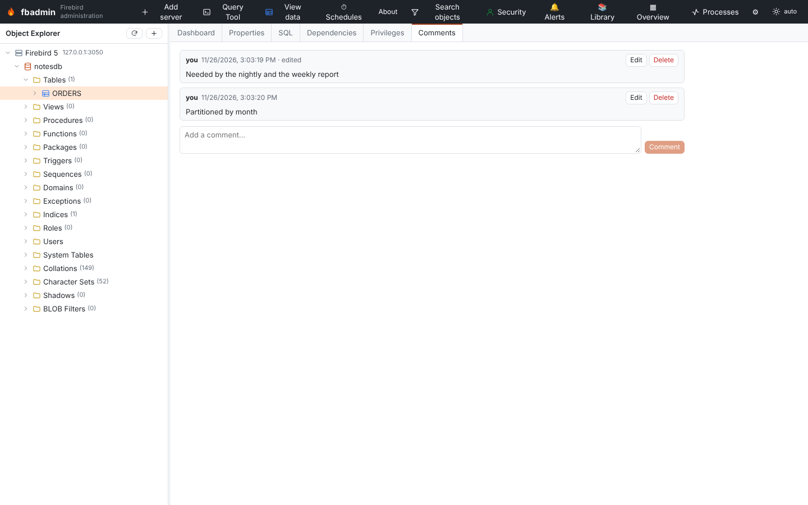

# Comments

Comments are short notes on a database object or a notebook. For example: "this index is needed by the
nightly report", or "partitioned by month, don't add columns without asking". They are shown where the
object is, so the next person to look at it reads them.

* **On an object:** select a table, view, index, procedure or any other object in the tree, then open
  its **Comments** tab.
* **On a notebook:** the comments are below the notebook's cells.

Write a comment and press **Comment** (or Ctrl+Enter). Comments are plain text, up to 4,000 characters.
You can **edit** and **delete** your own comments; edited comments say so. fbadmin administrators can
delete any comment.

## Who sees them

A comment can be seen by whoever can see what it is on:

* **an object:** users with at least the *read* level on that object. In server mode, an object rule
  that hides a table hides its comments too, and users without access to the database don't see them;
* **a notebook:** users who can see the notebook (its owner, or everyone when it is shared).

The same rule applies to writing comments. In desktop mode there is one user, who sees everything.

## What happens to them

* A comment stays when its object is dropped, and shows again if the object is created again under the
  same name. Comments go when their notebook is deleted.
* Each new comment raises the `comment.added` [alert event](ALERTS.md#events). A rule on that event,
  for one database or for all of them, tells a team when someone leaves a note.

Comments are kept in `<data dir>/comments.json`.

## API

| Method | Path | |
|---|---|---|
| GET | `/api/comments?server_id=&database_id=&otype=&name=&schema=` | the thread of an object, oldest first |
| GET | `/api/comments?kind=notebook&notebook_id=` | the thread of a notebook |
| GET | `/api/comments/counts?server_id=&database_id=` | objects of a database with comments, most recent first |
| POST | `/api/comments` `{kind, server_id, database_id, otype, name, schema \| notebook_id, text}` | add a comment |
| PUT | `/api/comments/{id}` `{text}` | edit your comment |
| DELETE | `/api/comments/{id}` | delete your comment (administrators: any) |
