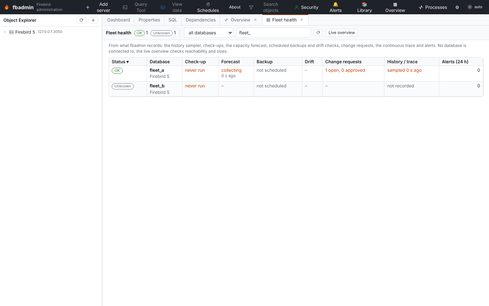

# Fleet health

**Fleet health** (a button on the [Overview](OVERVIEW.md) page, ▦ Overview in the top bar) shows every
database you can see in one table, with the newest of what fbadmin records about it. The worst
databases come first.

| Column | From |
|---|---|
| **Status** | the worst signal of the row: *critical*, *warning*, *OK*, or *unknown* when nothing is recorded yet; the problems that set it are listed under it |
| **Check-up** | the newest [performance check-up](MONITORING.md#performance-check-up), run by hand or [on a schedule](MONITORING.md#scheduled-check-up) |
| **Forecast** | the newest [capacity forecast](MONITORING.md#capacity-forecast): the nearest limit, or *no limit near* |
| **Backup** | the newest successful [scheduled backup](MAINTENANCE.md#scheduled-jobs), and whether a later one failed |
| **Drift** | the newest [schema drift check](SCHEMA_DRIFT.md) |
| **Change requests** | [change requests](CHANGE_REQUESTS.md) open, approved and failed |
| **History / trace** | when the [history](MONITORING.md#history) was last sampled, and the state of the [continuous trace](MONITORING.md#continuous-trace) |
| **Alerts (24 h)** | [alerts](ALERTS.md) sent for the database in the last 24 hours |

Click a cell to open that view of the database. Filter by status (or *needing attention*: critical and
warning), search by name or problem, and sort by the underlined column headers. The page refreshes every
minute.

**Opening the page connects to no database.** The values come from fbadmin's own records, so the page is
quick with many databases and never asks for a password; a check that never ran shows "never run", a
database without a backup schedule "not scheduled". For live reachability, sizes and connections, use the
[server overview](OVERVIEW.md) (**Live overview** on the page).

## What makes a row critical or a warning

| Critical | Warning |
|---|---|
| a critical check-up finding | a check-up warning |
| a critical forecast finding (a limit within 30 days, or 95 % used) | a forecast warning (within 180 days, or 80 % used) |
| the newest scheduled backup failed, or the newest successful one is more than a week old | the newest successful backup is more than 36 hours old |
| a critical alert in the last 24 hours | schema drift, a failed change request, sampling errors or no sample for an hour, the continuous trace not running |

## Weekly digest

A **Digest** schedule ([Scheduled jobs](MAINTENANCE.md#scheduled-jobs)) sends one message per database to
e-mail, Slack or webhook channels: what happened over the last 1, 7, 14 or 30 days. It covers:

* the status of the database and its problems, as on this page;
* the newest check-up, and the findings scheduled check-ups found new in the period;
* the capacity forecast's nearest limit, and how much the database grew;
* query regressions (the five worst);
* backups made and failed, and the newest;
* change requests proposed, applied, open and failed;
* errors seen by the [continuous trace](MONITORING.md#continuous-trace), with lock conflicts and the
  most frequent errors;
* alerts sent, by event, and new [comments](COMMENTS.md).

Like this page, the digest connects to no database. E-mails also carry it as a Markdown file. A run
fails only when no channel could be reached, and every run keeps the digest in the schedule's history.
In server mode the digest runs as the user who scheduled it.

## Who sees what

The table lists the databases you may read (in server mode, with at least the *read* level). The values
come from records any user of that database can open, such as the check-up report and the forecast.

## API

The digest is a schedule of kind `digest` with `{"digest": {"channels": [...], "days": 7}}`
(`/api/schedules`). `GET /api/fleet` returns `{generated_at, counts, databases: [...]}`; each database has `status`,
`problems`, `history`, `checkup`, `forecast`, `backup`, `drift`, `changes`, `trace`, `alerts_24h` and
`schedules`.
