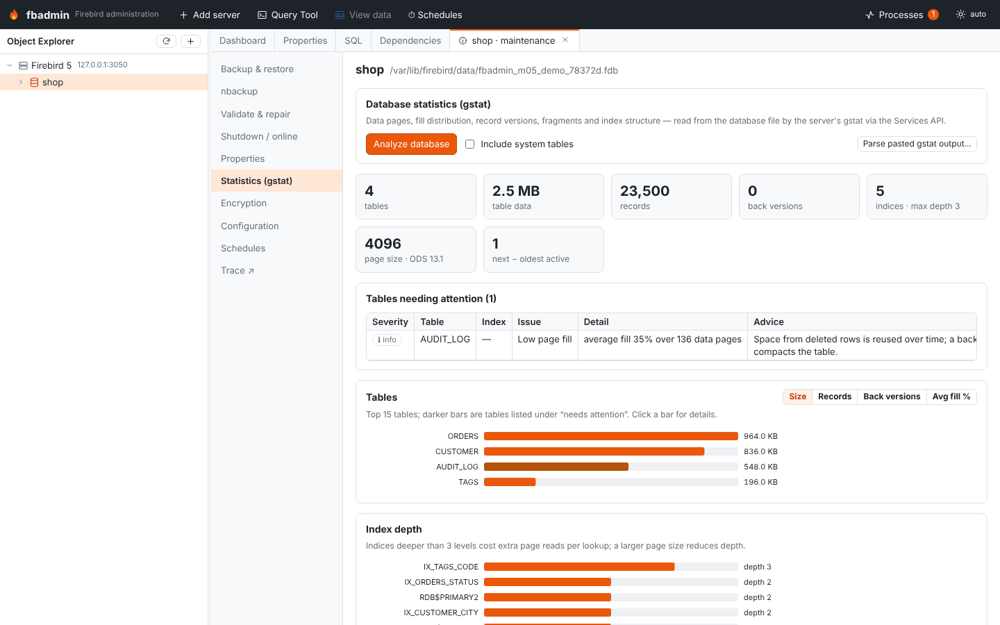
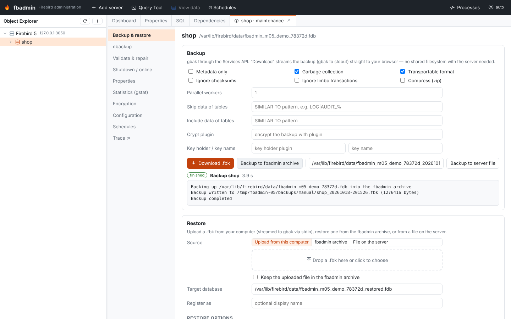
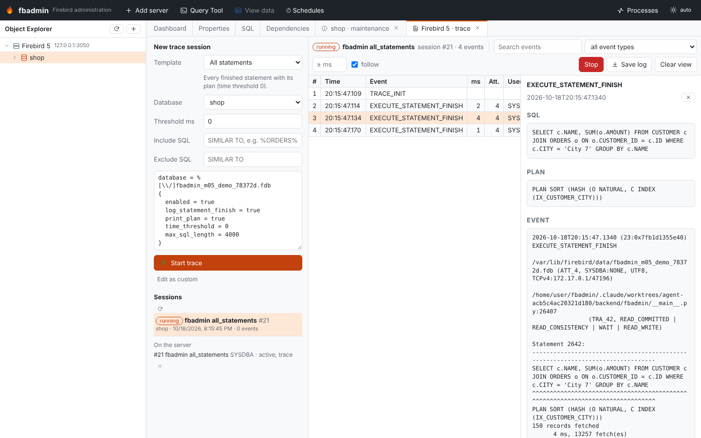
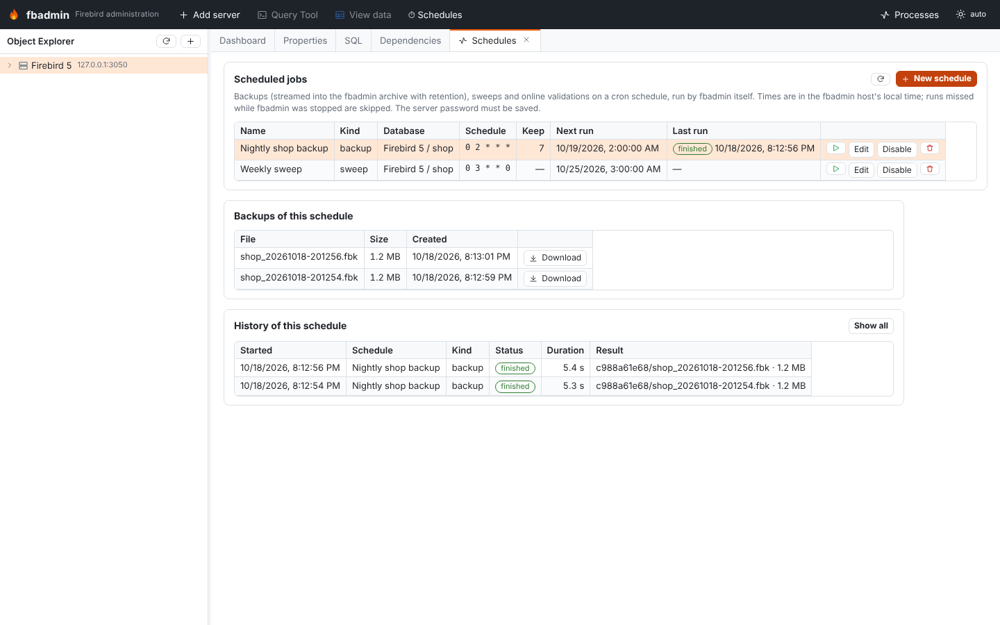

# Maintenance and server tools (milestone 0.5)

Everything here goes through the Firebird **Services API** (or plain SQL), so fbadmin
does not need access to the server's file system. Open the tools from the object
explorer: right-click a database → *Maintenance tools*, a server → *Server tools*,
or use the *Maintenance* block on the database dashboard and the **Schedules**
button in the top bar.

## Backup and restore through the browser

| Action | How it works |
|---|---|
| **Download .fbk** | `POST …/maintenance/backup/stream` starts gbak with `stdout` as the backup file and returns a one-time token; the browser then downloads `GET /api/servers/{sid}/maintenance/downloads/{token}`. Data is read with `isc_info_svc_to_eof` in 64 KB chunks and streamed — nothing is buffered in memory. Option errors are reported before the download starts. |
| **Backup to fbadmin archive** | Same stream, written to `<data dir>/backups/manual/*.fbk` as a background job. |
| **Backup to server file** | Classic gbak to a path on the Firebird server (verbose log in Processes). |
| **Upload & restore** | The browser sends the file as the raw request body; the backend spools it to `<data dir>/uploads` in chunks and runs gbak with `stdin` as the backup file, answering `isc_info_svc_stdin` requests from the file. Tick *Keep* to store the upload in the archive. |
| **Restore from archive / server file** | Restore a stored backup, or a `.fbk` that already sits on the server. |

Backup options: metadata only, garbage collection, transportable, ignore checksums/limbo,
**zip** (FB4+), **parallel workers** (FB5, `isc_spb_bkp_parallel_workers`), **skip data**
(FB3+) / **include data** (FB4+) table patterns (`SIMILAR TO`), **crypt plugin, key holder
and key name** (FB4+). Restore options: replace, page size, buffers, deactivate indices,
no validity, commit per table, use all space, metadata only, read-only, parallel workers,
skip/include data, crypt plugin/key, fix UNICODE_FSS data. Options that the server version
does not support are disabled in the UI and rejected by the API with a clear message.

## nbackup

* **Incremental backups** by level (`isc_action_svc_nbak`) to files on the server, optional
  direct I/O and "no database triggers". The history comes from `RDB$BACKUP_HISTORY`.
* **Lock / unlock** for file-system copies: `ALTER DATABASE BEGIN BACKUP` / `END BACKUP`.
  The state (normal / locked / merge) is shown from the header page and `MON$BACKUP_STATE`.
* **Fixup** (`nbackup -F`, `isc_action_svc_nfix`) — Firebird 4+ only (FB3 has no service for it).
* **Restore chain** (`isc_action_svc_nrest`): list the level 0, 1, … files in order.

## Validate & repair (gfix)

* **Online validation** (`isc_action_svc_validate`, FB3+) with table/index include/exclude
  patterns and lock timeout; **full** (`-v -full`), **read-only check** (`-v -n`) and **mend**.
* **Sweep** (FB5: parallel workers), **ICU fix** (`gfix -icu`, `isc_spb_rpr_icu`).
* **Limbo transactions**: list (`isc_info_svc_limbo_trans`), commit or roll back each one.

Full validation, mend and ICU need exclusive access; fbadmin closes its own connections first.

## Shutdown and online

New-style shutdown (FB 2.5+ SPB): mode **multi / single / full**, method **force /
attachments / transactions** with a timeout. Bring online as **normal, multi or single**.
Shutdown can only become more restrictive (multi → single → full); use *Bring online* with
a less restrictive mode to step back. The current state is read from the header page, so it
is visible even when the database is in full shutdown.

## Database properties

Page buffers, sweep interval, forced writes, reserve space, SQL dialect and read-only are
set through the Services API; **linger** (`ALTER DATABASE SET LINGER TO` / `DROP LINGER`)
and the **default character set** (`ALTER DATABASE SET DEFAULT CHARACTER SET`) through SQL.
Only changed fields are applied. Replication settings are handled by the replication feature.

## Statistics (gstat) charts

The server's gstat output (data + index pages + record versions) is parsed into JSON
(`fbadmin/maintenance/gstat.py`, unit-tested with real FB3/4/5 outputs in
`backend/tests/fixtures`). The UI shows summary cards, top tables by size / records / back
versions / fill, index depth, fill-distribution histograms per table and index, and a
**tables needing attention** list:

| Finding | Default rule |
|---|---|
| Many record versions | back versions ≥ 20 % of records (critical ≥ 100 %), tables ≥ 100 records |
| Long version chains | max versions ≥ 5 |
| Fragmented records | fragments ≥ 10 % of records |
| Low page fill | average fill < 50 % over ≥ 10 data pages |
| Deep index | depth ≥ 4 |
| Poor selectivity | max duplicates ≥ 90 % of ≥ 1000 nodes |
| Transaction gap | next − oldest active > 10 000 |

Output of a command-line `gstat -a -r` can be pasted and parsed too
(`POST /api/servers/{sid}/maintenance/gstat/parse`).

## Trace API

Start a trace session from a template — **slow queries** (statement/procedure/function
finish above a threshold, with plan and performance), **all statements**, **errors and
warnings**, **connections and transactions**, **PSQL execution** — or write a custom
configuration (the template config is shown and can be edited). Sessions are scoped to one
database (`database = %[\\/]<file name>`) or all databases, with optional include/exclude
SQL filters.

A background thread reads the trace output (`isc_info_svc_line` with a 1 s service timeout)
and splits it into events (time, type, attachment, user, duration, SQL, plan). The view
polls new events every second; filter by text, event type or minimum duration, follow the
tail, inspect an event, **stop** the session, **save the full log** (written to
`<data dir>/traces/<id>.log` while streaming). Sessions started elsewhere are listed (from
`isc_action_svc_trace_list`) and can be stopped. Configuration errors are reported by the
server per database when it is attached and show up as `TRACE_CONFIG_ERROR` events.

## Encryption

`ALTER DATABASE ENCRYPT WITH <plugin> [KEY <name>]` / `DECRYPT`; progress from
`MON$DATABASE.MON$CRYPT_PAGE / MON$PAGES` and `MON$CRYPT_STATE` (FB4+), polled while
encryption runs. A crypt plugin must be installed on the server — without one Firebird
reports "Crypt plugin … failed to load", which is shown as is.

## Configuration viewer

Read-only `RDB$CONFIG` (Firebird 4+): effective `firebird.conf` / `databases.conf` values
for the database, with default and source file. On Firebird 3 the page explains that the
viewer needs Firebird 4.

## Cancelling a job

Long operations run as background jobs (**Processes**, and the log under each form). A job that
can be stopped shows **Cancel** while it runs; it then ends with the status *cancelled*.

| Job | What Cancel does |
| --- | --- |
| Backup (to the fbadmin archive or to a server file), sweep, validation (not *mend*) | Detaches the attachment of the server's gbak or gfix from `MON$ATTACHMENTS`, which stops it at once. gbak removes its unfinished backup file on the server (Firebird 4 and later; Firebird 3 leaves it), and fbadmin removes its partial archive file. |
| Restore of a backup in the fbadmin archive or an upload | Stops sending the backup. gbak ends, and fbadmin drops the half-restored database when gbak's log shows it created that file. |
| Test restore of a backup, upgrade trial restore | As above. The scratch database is dropped. |
| Scheduled backup, sweep or validation | As above. The run is recorded as *cancelled* and raises no "job failed" alert. |
| Data compare, applying a sync script | Cancels the running statement from a second attachment (`MON$STATEMENTS`). Applying is rolled back. |

A restore from a backup file **on the server** cannot be cancelled. gbak runs inside the server,
and the database it restores stays in shutdown mode until it is finished, so no other attachment
can stop it. Restoring through the fbadmin archive (or an upload) can be cancelled.

To find exactly its own server work, a cancellable job attaches to the service manager with the
process name `fbadmin-job-<job id>`, which Firebird copies into the attachments of the gbak or
gfix it starts (`MON$REMOTE_PROCESS`). Other attachments are never touched. Cancelling needs
the right to delete those attachments: the same user, or SYSDBA/`RDB$ADMIN`.

## Scheduled jobs

pgAgent-like schedules for **backups** (streamed into `<data dir>/backups/<schedule id>/`
with **retention**: keep the last N files), **sweeps** and **online validations**.

* Standard 5-field cron expressions (`minute hour day-of-month month day-of-week`) with
  lists, ranges, steps, month/day names and `@hourly`/`@daily`/`@weekly`/`@monthly`/`@yearly`
  (own parser: `fbadmin/maintenance/cron.py`). The editor previews the next run times.
* Schedules and run history are stored in `<data dir>/schedules.json` and
  `schedule_history.json`. An in-process thread (started in the app lifespan) checks every
  15 s (`FBADMIN_SCHEDULER_INTERVAL`) and runs due schedules as normal background jobs.
* Times use the fbadmin host's local time. Runs missed while fbadmin was not running are
  skipped. The server password must be saved, otherwise the run fails with "password required".
* *Run now*, enable/disable, edit, delete (optionally with its backup files), history, and
  download of each stored backup.

### Test restores

A backup that cannot be restored is not a backup. With **Test-restore each backup** on, every
scheduled backup is restored into a scratch database on the same server, opened (fbadmin
counts its tables, indices and procedures) and dropped again. The run history shows the result.

* The scratch database goes next to the source database as `fbadmin_verify_<schedule id>.fdb`.
  For a database registered by alias, or to use another disk, set **Test-restore path on the
  server**. fbadmin refuses a path that is a registered database, overwrites a leftover only
  when its name starts with `fbadmin_verify_`, and drops only databases it created.
* **Old backups are only removed after the new one passed its test restore**, locally and in
  the cloud, and a backup that fails is not uploaded. A bad backup therefore never pushes out
  the last good ones. The run fails and raises the `backup.verify_failed` and `schedule.failed`
  alerts (see [Alerts](ALERTS.md)).
* **Test restore** next to each archived backup runs the same check on demand.
* Restoring needs disk space on the server for a second copy of the database, and time; for
  large databases run the verified schedule less often than the plain backup.

Scheduled **online validations** count the errors Firebird reports (`Relation 128 (T) : 2 ERRORS
found`). A validation with errors fails the run and raises the `validation.errors` alert.

Each schedule can also **upload** its backups to a cloud storage target (below), with its own
folder and its own retention (*Keep last N in the cloud*).

## Cloud storage targets

Backups can also be copied to object storage: **Amazon S3** (and S3-compatible services),
**Azure Blob Storage** and **Google Cloud Storage**. A backup is first written to the local
backup directory as before, then uploaded as `<target prefix>/<folder>/<file name>.fbk`.
Retention works like the local one: after the upload, the oldest `.fbk` objects directly in
that folder are deleted so that the newest *N* remain (other objects, and sub-folders, are
never touched; `0` keeps everything).

* Targets are stored in `<data dir>/storage_targets.json` (file mode `0600`). Only
  administrators can create, see or test them in server mode, since they hold credentials.
* **Secrets are never returned by the API.** Secret fields show as `********` with a
  `has_<field>` flag; when editing, leave a secret as `********` (or empty) to keep it.
* **`env:` references.** Any setting can be written as `env:NAME`; the value is then read
  from the fbadmin process environment each time the target is used, so secrets do not have to
  be stored in the file (for example `secret_access_key: env:AWS_SECRET_ACCESS_KEY`).
  References are not secret and are shown as they are.
* **Test** writes a tiny object named `<prefix>/.fbadmin-test-<random>`, lists it, reads its
  size and deletes it, and reports the provider's error code if any step fails.
* Uploads stream from disk in 16 MiB pieces (S3 multipart upload, Azure blocks, GCS resumable
  upload), so backups of any size are never held in memory; failed S3 multipart uploads are
  aborted. Requests have timeouts, network errors and 5xx/429 responses are retried, and
  `HTTPS_PROXY`/`NO_PROXY` are respected. No cloud SDK is needed: requests are signed by
  fbadmin itself (AWS Signature V4, Azure Shared Key, Google service-account JWT).

### Amazon S3 and S3-compatible storage

| Setting | Required | Notes |
|---|---|---|
| `bucket` | yes | |
| `region` | | default `us-east-1` |
| `access_key_id` | yes | |
| `secret_access_key` | yes | secret |
| `session_token` | | secret; for temporary (STS) credentials |
| `endpoint` | | S3-compatible services; default `https://s3.<region>.amazonaws.com` |
| `path_style` | | `true`/`false`; default `true` when an endpoint is set or the bucket name contains dots, else virtual-hosted (`<bucket>.s3…`) |
| `prefix` | | folder inside the bucket, e.g. `fbadmin/` |

S3-compatible endpoints, for example: MinIO `http://minio:9000`, Cloudflare R2
`https://<account id>.r2.cloudflarestorage.com` (region `auto`), Wasabi
`https://s3.<region>.wasabisys.com`, Backblaze B2 `https://s3.<region>.backblazeb2.com`,
SeaweedFS `http://<filer>:8333`.

The IAM policy needs `s3:PutObject`, `s3:GetObject`, `s3:DeleteObject` and
`s3:AbortMultipartUpload` on `arn:aws:s3:::<bucket>/<prefix>*` and `s3:ListBucket` (plus
`s3:ListBucketMultipartUploads` if you want to clean up) on `arn:aws:s3:::<bucket>`.

### Azure Blob Storage

| Setting | Required | Notes |
|---|---|---|
| `account` | yes | storage account name |
| `container` | yes | |
| `account_key` | one of these | secret; Shared Key authentication |
| `sas_token` | one of these | secret; a SAS with read, add, create, write, delete and list (`sp=racwdl`) on the container |
| `endpoint` | | default `https://<account>.blob.core.windows.net`; Azurite: `http://127.0.0.1:10000/devstoreaccount1` |
| `prefix` | | folder inside the container |

Files larger than one piece are uploaded with Put Block / Put Block List; uncommitted blocks of
an interrupted upload are discarded by Azure after a week. With an account key, the key gives
full access to the account; a container SAS (or a SAS with an expiry you rotate) is narrower.

### Google Cloud Storage

| Setting | Required | Notes |
|---|---|---|
| `bucket` | yes | |
| `service_account_json` | yes, unless `endpoint` is set | secret; the full JSON key file of a service account |
| `endpoint` | | default `https://storage.googleapis.com`; e.g. a fake-gcs-server. Without a key, no credentials are sent |
| `prefix` | | folder inside the bucket |

The service account needs **Storage Object Admin** (`roles/storage.objectAdmin`) on the bucket.
fbadmin exchanges a signed JWT for an OAuth2 access token (scope `devstorage.read_write`) and
caches it until it expires.

### Testing against emulators

`scripts/storage-test-servers.sh` starts SeaweedFS (S3 with authentication), Azurite and
fake-gcs-server in Docker and prints the variables for `backend/tests/test_storage_real.py`;
CI runs the same tests. `backend/tests/test_storage.py` checks the request signing against AWS's
published Signature V4 examples and needs no network.

## API overview

| Endpoint | Purpose |
|---|---|
| `GET /api/servers/{sid}/maintenance/capabilities` | engine version and supported options |
| `POST …/databases/{db}/maintenance/backup/stream` → `GET …/maintenance/downloads/{token}` | streamed download |
| `POST …/databases/{db}/maintenance/backup` | backup job (`target`: `archive` or `server`) |
| `POST /api/servers/{sid}/maintenance/restore` | restore job from `archive` or `server` file |
| `POST /api/jobs/{job}/cancel` | cancel a running job (`cancellable: true` in its summary) |
| `POST /api/servers/{sid}/maintenance/restore/upload?database_path=…` | raw-body upload + restore |
| `GET/DELETE /api/servers/{sid}/maintenance/archive`, `GET …/archive/download?path=` | archive |
| `POST …/maintenance/nbackup`, `/nbackup/lock`, `/nbackup/unlock`, `/nbackup/fixup`, `GET /nbackup/history` | nbackup |
| `POST /api/servers/{sid}/maintenance/nrestore` | restore an nbackup chain |
| `POST …/maintenance/validate`, `/sweep`, `/icu` | gfix jobs |
| `GET …/maintenance/limbo`, `POST …/limbo/{id}/{commit\|rollback\|recover}` | limbo |
| `POST …/maintenance/shutdown`, `/online` | shutdown / online |
| `GET/PUT …/maintenance/properties` | properties |
| `POST …/maintenance/gstat` → `GET /api/servers/{sid}/maintenance/gstat/{job}` | parsed statistics |
| `POST …/maintenance/encrypt`, `/decrypt`, `GET /crypt-state` | encryption |
| `GET …/maintenance/config` | RDB$CONFIG |
| `/api/servers/{sid}/trace/…` | templates, preview, sessions, events, stop, download |
| `/api/schedules/…` | schedules CRUD, run, history, backups, cron preview |
| `POST /api/schedules/{id}/backups/verify` (`{"path": …}`) | test restore of one archived backup (job) |
| `GET/POST /api/storage/targets`, `GET/PUT/DELETE /api/storage/targets/{id}` | cloud storage targets (admins only in server mode) |
| `POST /api/storage/targets/{id}/test`, `GET …/targets/{id}/objects?prefix=` | test a target, list its objects (newest first) |

`…` = `/api/servers/{sid}/databases/{db}`.

## Implementation notes

* `fbadmin/maintenance/svc.py` builds raw SPBs and runs the service query loop itself
  (the pure-Python driver only implements a few actions and reads line lengths as one byte).
* Tests: `backend/tests/test_maintenance.py` (live server: roundtrips with data
  verification, nbackup chain, shutdown/online, properties, limbo via a prepared 2PC
  transaction, validation, gstat, trace, scheduler, RDB$CONFIG, encryption error path) and
  `test_maintenance_units.py` (parser, cron, trace parsing, SPB). They pass on Firebird 3, 4 and 5;
  version-gated features assert the "requires Firebird N" error on older servers.
* nbackup and "backup to server file" tests leave their `.nbk`/`.fbk` files in the server's
  data directory (the Services API cannot delete files).
