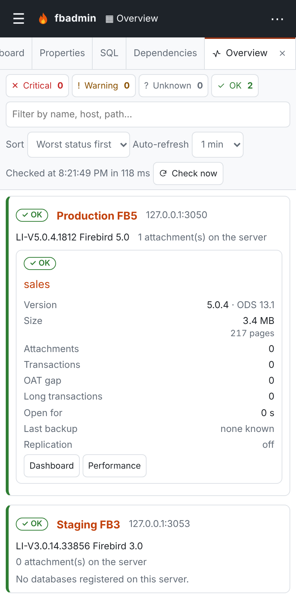
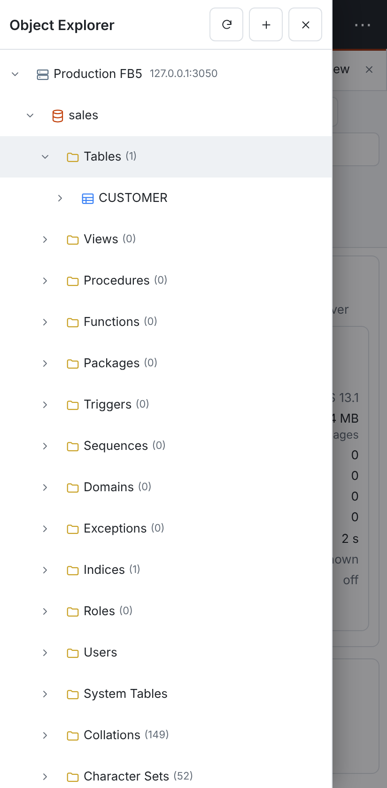
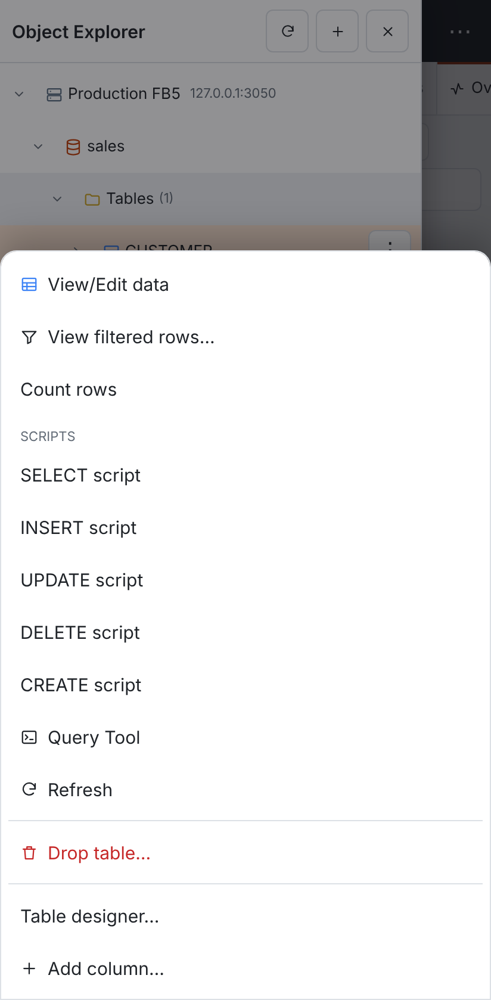

# Phones and tablets

fbadmin works in the browser of a phone or tablet, so you can check on your servers away from a
desk. Nothing needs installing or switching on: the layout adapts to the screen size.

| Screen | Layout |
|---|---|
| Phone (narrower than 640 px) | The Object Explorer is a drawer, the toolbar buttons are in a **⋯** menu, one panel at a time, dialogs fill the screen. |
| Tablet (640–1023 px, and touch screens up to 1366 px such as an iPad in landscape) | The desktop layout with a collapsible Object Explorer and the **⋯** menu. |
| Desktop (1024 px and wider, with a mouse) | Unchanged. |

{ width="240" }
{ width="240" }
{ width="240" }

## On a phone

- **Start page.** If servers are registered, fbadmin opens the
  [multi-server overview](OVERVIEW.md). Each database is a card with its status, attachments,
  transactions, OAT gap, long transactions, last backup and replication. **Dashboard** and
  **Performance** open the database.
- **Object Explorer.** Tap **☰** to open it. Tap a server, database or object to open it: the
  drawer closes and its dashboard or properties are shown. Tap the arrow in front of a row to
  expand it without opening it. To close the drawer, tap outside it, swipe it to the left, tap
  **×**, or press Escape.
- **Context menus.** Touch and hold a row in the Object Explorer, or tap the **⋮** button on the
  selected row. The menu opens as a sheet along the bottom of the screen. Tap outside it to close it.
- **Toolbar.** **▦ Overview** stays in the top bar. The other buttons (Query Tool, Add server,
  Schedules, Alerts, Library, Processes, Preferences, the theme and, in server mode, your user menu
  with **Sign out**) are in the **⋯** menu.
- **Tabs.** Open tabs form a strip that scrolls sideways. One panel is shown at a time, full width.
- **Tables.** Wide tables such as attachments, transactions and query results scroll sideways
  inside their own box. The page itself does not.
- **Dialogs** fill the screen, with labels above the fields and a **×** button to close them.

### Quick actions

These work comfortably with touch:

| Task | Where |
|---|---|
| Health of every server | **▦ Overview** (the start page) |
| Attachments, running statements, transactions; **Disconnect** an attachment, **Cancel** a statement | database dashboard → **Monitor** |
| Long transactions and who holds the OAT | database menu → **Transactions & OAT** |
| Live counters and charts | database menu → **Performance dashboard** |
| Scheduled jobs, run history, **Run now** (▶) | **⋯** → **Schedules** |
| Alert rules and sent alerts | **⋯** → **Alerts** |
| Replication status | database menu → **Replication** |
| Recent `firebird.log` | server menu → **Server log** |
| A quick `SELECT` | **⋯** → **Query Tool**, or the database menu → **Query Tool** |

In the Query Tool, the toolbar is one row that scrolls sideways and the editor is shorter, so the
results stay in view.

The table designer, ERD, visual query builder and other editing tools open on a phone without
breaking the page, but they need a bigger screen to be comfortable.

## On a tablet

The Object Explorer is a sidebar (260 px wide at first). **☰** hides or shows it, and fbadmin
remembers your choice in the browser. Context menus open next to the row, as on a desktop.

On touch screens, tree rows, menu items and toolbar buttons are at least 44 px high, and the
selected tree row has a **⋮** button for its context menu. This applies to touch laptops too.

## Add to the home screen

fbadmin has a web app manifest and icons, so you can add it to your home screen. It then opens in
its own window without the browser's address bar.

- **iPhone and iPad (Safari):** tap Share, then **Add to Home Screen**.
- **Android (Chrome):** open the browser menu, then **Add to Home screen** or **Install app**.

fbadmin has **no service worker and no offline mode**. This is deliberate: it is a live
administration tool, and a cached page or cached numbers could show a database as healthy when it
is not. Without a connection to the fbadmin server, the page does not load.

To reach fbadmin from a phone, run it in [server mode](SECURITY.md) behind HTTPS (see
[deployment](admin/deployment.md)), and sign in as usual. Two-factor sign-in works on phones as
well.

## Accessibility

The phone and tablet layouts are checked with axe in the light, dark and high-contrast themes,
including the WCAG 2.2 target-size rule. The drawer moves focus into itself when it opens and back
to **☰** when it closes, and the rest of the page is inert while it is open. Animations are turned
off when the system asks for reduced motion.

## Limitations

- Full editing tools (table designer, ERD, query builder canvas, schema diff) are usable but
  cramped on a phone; use a tablet or desktop for them.
- Dragging (the Object Explorer to the query builder, column resizing, the splitters) needs a mouse.
- On touch screens there are no hover tooltips.
