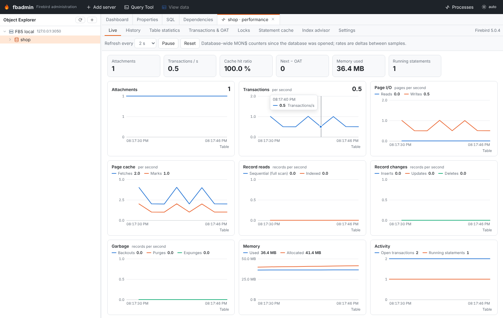
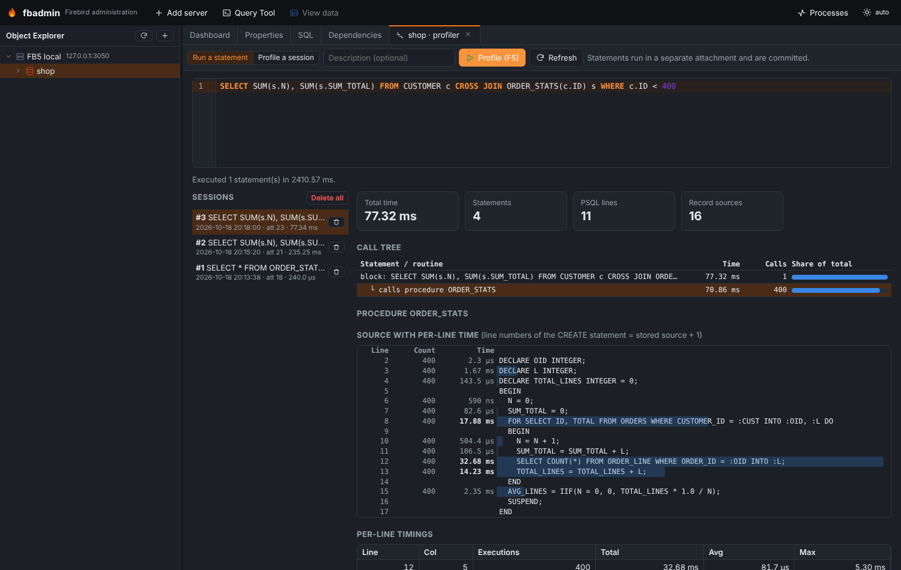
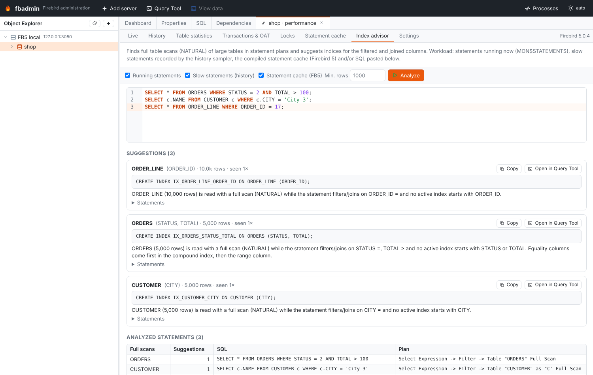

# Monitoring and performance

Milestone 0.7. Everything here reads the `MON$` monitoring tables (or the Firebird 5 profiler
tables) over a normal attachment. Nothing needs to be installed on the server.

Open it from a database's context menu (**Performance check-up**, **Performance dashboard**, **Transactions & OAT**,
**Index advisor**, **Profiler**) or from the **Health** section of the database dashboard.



## Feature matrix

| Feature | Firebird 3 | Firebird 4 | Firebird 5 |
|---|---|---|---|
| Live charts, history, Prometheus metrics | ✓ | ✓ | ✓ |
| Table statistics (`MON$TABLE_STATS`) | ✓ (3.0.x has it) | ✓ | ✓ |
| Long-running transactions, OIT/OAT alerts, OAT holder | ✓ | ✓ | ✓ |
| Lock waits and likely blockers | ✓ | ✓ | ✓ |
| Lock manager settings (`RDB$CONFIG`) | – | ✓ | ✓ |
| Compiled statement cache (`MON$COMPILED_STATEMENTS`) | – | – | ✓ |
| Profiler (`RDB$PROFILER`, `PLG$PROF_*`) | – | – | ✓ |
| Index advisor | ✓ | ✓ | ✓ (plus the statement cache as a workload) |
| Performance check-up | ✓ | ✓ | ✓ (server mode from `RDB$CONFIG` on 4 and 5) |
| Capacity forecast (size, transactions, sequences, formats) | ✓ | ✓ | ✓ (and `INT128` columns on 4 and 5) |
| Continuous trace (statements as they finish, with explained plans) | ✓ | ✓ | ✓ |

Features are detected at runtime (by looking for the system tables or packages), not by version.
Where a feature is missing the UI says so instead of failing.

## Live dashboard

The **Live** tab polls `GET …/monitoring/snapshot` (1–30 s) and keeps the last 180 samples in
the browser. A snapshot is one query over `MON$DATABASE` joined with the database-level
`MON$IO_STATS`, `MON$RECORD_STATS` and `MON$MEMORY_USAGE`, plus counts of attachments,
transactions and running/stalled statements.

Counters are cumulative since the database was opened by its first attachment; the charts show
per-second deltas between consecutive samples. If the last attachment disconnects, the counters
reset: that interval is shown as a gap.

Charts: attachments, transactions/s (delta of `MON$NEXT_TRANSACTION`), page reads/writes,
page fetches/marks, sequential vs indexed record reads, inserts/updates/deletes, garbage
(backouts/purges/expunges), memory used/allocated, open transactions and running statements,
next transaction − OAT, and lock contention (record waits and update conflicts). The tiles above
show the latest values and the cache hit ratio (1 − reads/fetches).

The charts are inline SVG (no chart library): one y axis each, a crosshair tooltip that lists
every series, keyboard support (focus a chart, ←/→ move the crosshair) and a **Table** toggle
that shows the same numbers as a table. Colors are CSS variables in
`frontend/src/features/monitoring/monitoring.css` with separate light/dark values.

## History

Enable **Record history for this database** in the **History** tab. A background thread
(started from the FastAPI lifespan) takes a snapshot of every opted-in database every
*interval* seconds and stores it in `monitoring.sqlite` in the data directory
(`~/.fbadmin` or `FBADMIN_DATA_DIR`). Samples older than the retention are pruned.
Ranges: 1 h, 6 h, 24 h, 3 d, 7 d (down-sampled to 500 points).

While sampling, statements that have been running for longer than *slow_seconds* are recorded
(SQL text, explained plan, longest duration, how often seen). They are listed under the history
charts and feed the index advisor. With the [continuous trace](#continuous-trace) on, every slow
statement is recorded when it finishes instead.

Settings (**Settings** sub-tab, or `PUT /api/monitoring/settings`); environment variables give
the defaults:

| Setting | Env | Default |
|---|---|---|
| `interval` (s, 0 = sampler off) | `FBADMIN_HISTORY_INTERVAL` | 60 |
| `retention_hours` | `FBADMIN_HISTORY_RETENTION_HOURS` | 168 |
| `slow_seconds` (0 = off) | `FBADMIN_HISTORY_SLOW_SECONDS` | 5 |
| `metrics_enabled` | `FBADMIN_METRICS` | off |

### Continuous trace

The sampler sees only the statements running at the moment it samples. A statement that takes three
seconds between two samples a minute apart is never seen. **Continuous trace** (in the **History** tab,
once the history is recorded) keeps a [trace session](MAINTENANCE.md#trace-api) running for the database.
The session reports each statement when it finishes, with its exact duration and plan.

* Statements slower than the threshold you set (200 ms by default) are recorded as runs for
  [query regressions](#query-regressions). The ones slower than *slow_seconds* also go to the slow
  statement list. Plans are captured with `explain_plan`, the same format as `MON$EXPLAINED_PLAN`, so
  turning the trace on does not look like a plan change.
* While the trace runs, the sampler and the Query Tool stop recording runs and slow statements of that
  database: the trace sees them all, and counting them twice would skew the medians. A statement still
  running shows in the live dashboard, and is recorded when it finishes.
* fbadmin keeps the session running. It starts one when the trace is turned on and when fbadmin
  starts, and a new one when the session ends (the server restarted, or someone stopped it). After a
  failure it waits 30 s, doubling up to 10 minutes. The panel shows the session, the statements
  recorded, the last error and the next try.
* At most 6000 statements a minute are recorded per database (`FBADMIN_TRACE_CAPTURE_PER_MINUTE`); the
  rest are counted as dropped. Raise the threshold on a busy database.
* The session is named *fbadmin continuous capture: <database>*. It writes no log file, and it runs as
  the Firebird user of the server registration. Without SYSDBA (or the `TRACE_ANY_ATTACHMENT`
  privilege) it sees only that user's own connections.
* Turning the history off (or deleting it) stops the trace. In server mode, turning it on needs the
  *admin* level on the database; the session then runs as the user who turned it on.

## Performance check-up

**Performance check-up…** (database context menu) answers "why is it slow?" with one ranked report.
It reads what fbadmin already collects and turns it into findings, most important first. Each finding
says what was found, the numbers behind it, what to do, and has buttons that do it.

The check-up runs as a job. With **Include gstat** (the default) it also reads the whole database with
gstat. That finds record versions and the real index selectivity, and takes as long as a gstat run.
Without it the check-up takes a second or two. The last report of each database is kept until fbadmin
restarts.

| Finding | From | Fix actions |
|---|---|---|
| **The oldest active transaction is stuck** (next − OAT ≥ 10,000; critical at 100,000) | `MON$DATABASE`, `MON$TRANSACTIONS`; who holds it | Show transactions; disconnect the holder's attachment |
| **Statements waiting for a record lock** right now, and who blocks them | `MON$STATEMENTS`, `MON$RECORD_STATS`, `MON$TABLE_STATS` | Show locks; disconnect a blocker |
| **The database is locked by nbackup** (or the delta is being merged) | `MON$BACKUP_STATE` | Open incremental backup |
| **Indices without selectivity although their table has rows**: created on an empty table, then loaded | `RDB$INDICES.RDB$STATISTICS` = 0, one row read | Recompute selectivity (`SET STATISTICS INDEX`) |
| **Outdated selectivity**: stored and actual differ by 3× or more (indices with ≥ 100 entries) | gstat: actual = 1 / (nodes − total dup) | Recompute selectivity |
| **Statements that got slower** | [query regressions](#query-regressions) | Open query regressions |
| **Tables with many old record versions** or long version chains | gstat | Sweep now; open statistics |
| **Page fetches that miss the cache** (≥ 5 % of ≥ 20,000 fetches) while the cache is smaller than the database | `MON$IO_STATS`: the history's last hour when recorded, else since the database was opened | Set the page buffers in the header (up to 2 GB; 128 MB in Classic and SuperClassic, where every connection has its own cache) |
| **The oldest interesting transaction is stuck** (OAT − OIT ≥ 10,000) | `MON$DATABASE`, sweep interval | Sweep now; turn on automatic sweep |
| **Frequent lock waits and update conflicts** | `MON$RECORD_STATS`: the last hour, else since opened | Show locks |
| **Long transactions** (≥ 30 min) other than the OAT holder | `MON$TRANSACTIONS` | Show transactions |
| **Inactive indices** | `RDB$INDICES.RDB$INDEX_INACTIVE` | `ALTER INDEX ... ACTIVE` in the Query Tool |
| **Missing indices** for slow statements | the [index advisor](#index-advisor) over the slow statement log and the statement cache | Open the index advisor; `CREATE INDEX` in the Query Tool |
| **Automatic sweep is off and no sweep is scheduled** | sweep interval, schedules | Schedule a sweep; turn on automatic sweep (20,000) |
| **Fragmented, sparse or deep** tables and indices | gstat | Open backup and restore |
| **Indices with very few distinct values** | gstat | — |
| **History isn't recorded** (cache, lock and regression checks are less precise without it) | | Record history for this database |

Findings are ranked by severity (critical, warning, note), then by how directly they slow queries
down. A stuck OAT always ranks at least as high as the record versions it causes. Actions that change
something ask first where it matters (disconnecting, sweeping, writing the page buffers) and the
check-up runs again when they finish. New page buffers take effect when the database is next opened.

The thresholds can be changed with `FBADMIN_CHECKUP_GAP_WARN` (transactions, default
`FBADMIN_OVERVIEW_GAP_WARN` or 10000) and `FBADMIN_CHECKUP_LONG_TX` (seconds, default 1800). Running a
check-up needs the admin level on the database; reading the last report needs read access.

### Scheduled check-up

**Schedule…** on the check-up page (or a *Performance check-up* job under
[Scheduled jobs](MAINTENANCE.md#scheduled-jobs)) runs the check-up on a cron schedule. It alerts only
on what is new since the previous run, so a database with a known, accepted note does not send the same
message every night:

* A finding is **new** when it was not there in the previous run, when it got more severe (a warning
  that became critical), or when it names objects it did not name before. For example, another index
  with outdated selectivity after a load, or another long transaction.
* **Alert on**: new warnings and critical findings (the default), or new critical findings only. Notes
  never alert.
* **Never alert on**: finding types to leave out, such as a page cache you sized on purpose.
* **Recompute missing or outdated selectivity at once**: the usual fix after a bulk load. The indices
  are recomputed right after the check-up and their findings are not alerted on. The run's history and
  the report list them.
* **Include gstat** reads the whole database; turn it off for a large database checked often.
  Outdated selectivity and record versions need gstat; missing selectivity does not.

Messages go to the alert rules on the `checkup.findings` [event](ALERTS.md#events). There is one message
per run with new findings (critical when one of them is), listing the new ones and how many earlier ones
are still there. One *resolved* message follows when nothing is left to alert on. The scheduled run's
report becomes the check-up page's report, marked *by the scheduled check-up …*. The run also appears
in the database's [timeline](TIMELINE.md). A run whose findings are not all gone shows the status
*findings*. Scheduling a check-up needs the admin level on the database, like any scheduled job.

### AI inspection

When the AI assistant is on (`FBADMIN_AI_PROVIDER=anthropic`, see the [AI assistant](QUERY_TOOL.md#ai-assistant-opt-in)),
the check-up has an **AI inspection** panel. **Inspect with AI** sends the last report to the assistant.
It answers in three parts:

* **Diagnosis**: the likely reasons the database is slow, connecting the findings. For example, a stuck
  transaction explains the record versions, and outdated selectivity explains a regressed statement.
* **Recommendations**: ranked by impact. Each one names the findings it addresses, the SQL or setting
  to apply, and its risk or cost.
* **What to check next**: measurements that would confirm or rule out the diagnosis.

SQL blocks in the answer can be opened in the Query Tool or copied. **Ask a follow-up question** keeps
the conversation going; the assistant sees its earlier answers. The answers are kept with the report and
are dropped when the check-up runs again.

What is sent:

* the findings with their evidence and the fixes offered;
* the key numbers and database properties;
* the performance settings from `RDB$CONFIG` (Firebird 4 and later);
* the largest tables from gstat;
* the ten slowest statements from the history, with their plans;
* the definitions of the tables they involve (at most eight).

Table data is never sent, and IP addresses are masked. **What is sent…** shows the exact prompt. The
inspection runs as a job and needs the admin level on the database.

## Query regressions

**Query regressions…** (database context menu) shows statements that got slower, or changed their plan
and got slower, over time. It needs the history to be recorded for the database.

**What is tracked.** Two sources feed it:

* **The history sampler.** Statements it sees running for longer than *slow_seconds*, with their
  `MON$EXPLAINED_PLAN`. One execution seen by several samples is one run, with the longest duration
  seen.
* **The Query Tool.** Statements (SELECT, INSERT, UPDATE, DELETE, MERGE, EXECUTE PROCEDURE) slower than
  *regression_query_ms*. Their plan is explained in the background after they ran.

Statements are grouped by their shape: literals and parameters become `?`, comments and spacing go,
case is folded outside quoted names, and `IN (1, 2, 3)` is `IN (?)`. So `WHERE ID = 7` and
`where id=8` are one statement.

**When a statement regressed.** Its **recent** runs (the last *regression_recent_hours*) are compared
with its **baseline** (the *regression_baseline_days* before them, and after it was last accepted). It
regressed when either holds:

* **slower**: the recent median is at least *regression_factor* times the baseline median, and at least
  *regression_min_seconds* more, with *regression_min_runs* runs on each side;
* **plan changed and slower**: the latest plan differs from the baseline's usual plan, and the median
  is more than 20 % and *regression_min_seconds* higher.

A changed plan that isn't slower is shown (**Regressions and changed plans**), not flagged.

**The screen.** The list shows each statement's baseline and recent medians, the change (×), the runs
and the flags; regressions come first. A statement's detail shows:

* a chart of every run's duration over time, one colour per plan;
* the plans with their runs and medians;
* a side-by-side diff of the baseline plan and the recent plan;
* **Open in Query Tool**, and **Accept as the new baseline…**, which makes the current plan and duration
  normal (the comparison starts again).

**Alerts.** The `query.regression` alert (see [Alerts](ALERTS.md)) is sent when a statement regresses,
again when its regression changes (another plan, or newly slower), and once when it is back to normal.
The check runs after each sample.

Settings (the screen's **Settings…**, or `PUT /api/monitoring/settings`):

| Setting | Default | |
|---|---|---|
| `regression_factor` | 2 | slower when the recent median is at least this many times the baseline median |
| `regression_min_seconds` | 0.5 | ... and at least this many seconds more |
| `regression_recent_hours` | 24 | the recent runs |
| `regression_baseline_days` | 14 | the baseline, before the recent runs |
| `regression_min_runs` | 3 | runs needed on each side |
| `regression_query_ms` | 200 | Query Tool statements slower than this are tracked |
| `regression_keep_days` | 30 | runs are kept this long (at most 2000 per statement) |

## Capacity forecast

**Capacity forecast…** (database context menu) projects the growth of a database to the limits it
runs into, so they show up weeks or months before they stop the application:

* **Database size** against a **space budget** you set (Firebird cannot tell how much of its disk is
  free): the growth per day, the size in 30 days, 90 days and a year, and when the budget is reached.
* **Transactions:** the next transaction number against the limit, 2^48−1 on Firebird 3 and later
  (ODS 12+), 2^31−1 before.
* **Sequences** against the column they fill. A sequence counts to 2^63, but an `INTEGER` column stops
  at 2,147,483,647 and a `SMALLINT` at 32,767. Identity columns are matched exactly; for other
  sequences, fbadmin takes the single-column integer primary key of a table whose triggers use the
  sequence (`GEN_ID` or `NEXT VALUE FOR`), marked *probably (trigger)*. A sequence that feeds no known
  column is measured against `BIGINT`.
* **Table formats:** each `ALTER TABLE` that changes a table's columns adds a format; at 255 the table
  cannot be changed until a backup and restore renumbers them.

**Observations.** The forecast keeps one observation (pages, page size, next transaction, the value of
every sequence) at most once an hour: the [history sampler](#history) records one for the databases
whose history is recorded, and opening the page records one if the last is an hour old. **Record an
observation now** records one at once. Observations are kept for two years and deleted with the
database's history.

**Trends** are least-squares slopes over the observations of the last 30 days, and need observations
at least 6 hours apart. A limit is a *warning* when it is reached within 180 days or 80 % used, and
*critical* within 30 days or 95 % used.

**Alerts.** A rule on the `capacity.forecast` [alert event](ALERTS.md#events) sends a message when a
finding appears or gets worse (once per finding and severity), checked after each history sample.

## Table statistics

Top tables by reads, sequential/indexed reads, inserts, updates, deletes, backouts, purges,
expunges, lock waits, conflicts or back-version reads, from `MON$TABLE_STATS` (stat group 0,
the whole database). System tables are hidden by default.

## Compiled statement cache (Firebird 5)

`MON$COMPILED_STATEMENTS`: SQL and PSQL routines in the cache with their explained plan, how
many `MON$STATEMENTS` currently use each one, and their I/O, record and memory counters. Click a
row to see the full SQL and plan.

## Transactions, OIT/OAT gaps and who holds the OAT

`GET …/monitoring/transactions?long_running=300&gap_warn=10000`

* gaps: next − OAT, OAT − OIT, next − OIT, next − OST;
* **OAT holder**: the transaction whose id equals `MON$OLDEST_ACTIVE` (or the oldest
  transaction that pins it), joined with its attachment (user, address, process, PID) and its
  statements. "Idle in transaction" is called out when no statement runs in it. You can
  disconnect the attachment from there;
* alerts: next − OAT above the threshold (critical at 10×), OAT − OIT above the threshold (with
  a sweep hint), and transactions older than *long_running* seconds. fbadmin's own metadata
  connection and system attachments (garbage collector, cache writer) are not reported.

The same alerts are shown in the **Health** section of the database dashboard.

## Locks and deadlocks

Firebird has no remote equivalent of `fb_lock_print`: the lock table lives in shared memory on
the server and is only readable by a local tool. The **Locks** tab shows what *is* available
remotely:

* statements waiting for a record lock: `MON$STATEMENTS` with `MON$RECORD_WAITS > 0` in their
  `MON$RECORD_STATS`, the transaction's lock timeout, and the tables they wait on
  (per-statement `MON$TABLE_STATS`);
* **likely blockers**: other live transactions that changed (inserted/updated/deleted/locked)
  records of the same tables (per-transaction `MON$TABLE_STATS`). Cancel the waiting statement or
  disconnect the blocker;
* statements with update conflicts, all running statements, lock timeouts of transactions;
* lock manager configuration from `RDB$CONFIG` (Firebird 4+): `DeadlockTimeout`, `LockMemSize`,
  `LockHashSlots`, `LockAcquireSpins`, …

Deadlocks are reported to the losing statement as an error (`deadlock` / `update conflicts with
concurrent update`); they are not kept in `MON$`. For lock-table level analysis run
`fb_lock_print -d <database>` on the server.

## Profiler (Firebird 5)



* **Run a statement**: fbadmin opens a separate attachment, calls
  `RDB$PROFILER.START_SESSION(description, NULL, NULL, NULL, 'DETAILED_REQUESTS')`, runs the
  statements (fetching all rows), then `RDB$PROFILER.FINISH_SESSION(TRUE)` and commits.
  `DETAILED_REQUESTS` is needed for per-request timings in `PLG$PROF_REQUESTS`.
* **Profile a session**: start profiling another attachment — for example a Query Tool tab (its
  attachment id is in the Query Tool status bar; fbadmin marks its own Query Tool attachments) —
  run statements there, then **Finish** (`FINISH_SESSION(TRUE, attachment_id)`).
* Procedures and functions have a **Profile…** item in their context menu.

The report shows:

* a **call tree** of statements: blocks, their child statements and the routines they call
  (from `PLG$PROF_STATEMENTS` parent ids and `PLG$PROF_REQUESTS` caller ids) with total time,
  call count and share of the total;
* **PSQL hot spots** (top lines across all routines) from `PLG$PROF_PSQL_STATS_VIEW`;
* for a routine: its **source with per-line counts and times** as a heat bar. Line numbers of
  the profiler are relative to the original `CREATE` statement while `RDB$…_SOURCE` starts after
  `AS`; fbadmin estimates the offset by matching the profiled (line, column) pairs to token
  starts in the stored source;
* for a statement: its **record sources** (access paths) with open/fetch counters and times
  from `PLG$PROF_RECORD_SOURCE_STATS_VIEW`.

Sessions can be deleted one by one or all at once. On Firebird 3/4 the tab explains that the
profiler needs Firebird 5.

## Index advisor



Workload sources (any combination): statements running now (`MON$STATEMENTS` with their explained
plan), slow statements recorded by the history sampler, the compiled statement cache (Firebird 5)
and SQL pasted in the editor (prepared to get its plan; nothing is executed).

For each statement:

1. the plan is parsed for full scans: `Table "T" as "A" Full Scan` in explained plans, or
   `PLAN (A NATURAL)` in legacy plans;
2. the SQL is parsed (regular expressions over the text with string literals blanked) for table
   aliases and `WHERE` / `JOIN … ON` predicates: equality (`=`, `IN`, `IS`), range (`<`, `>`,
   `BETWEEN`, `STARTING WITH`, `LIKE 'abc%'`), function-wrapped (`UPPER(col) = …`) and
   non-sargable (`<>`, `NOT …`, `CONTAINING`, `LIKE '%x'`);
3. the scanned table's size is estimated with a bounded `COUNT(*)` (capped at 1,000,000 rows);
   tables below *min rows* (default 1000) are skipped with a note;
4. if no active index starts with a filtered/joined column, a `CREATE INDEX` is suggested:
   equality columns first, then one range column (at most three columns); `UPPER/LOWER/TRIM(col)`
   predicates get a `COMPUTED BY` expression index;
5. if an index exists but the table is still scanned, a note lists possible causes (stale
   selectivity → `SET STATISTICS INDEX`, type mismatch, `OR`, low selectivity).

Suggestions are ranked by total observed time, then occurrences and table size. Each has the DDL
(copy / open in the Query Tool), the reasoning and the statements it came from. This is a
heuristic: check the new plan after creating an index.

## Prometheus exporter

Disabled by default. Enable with `FBADMIN_METRICS=1` or in **Settings**. Then `GET /metrics`
returns the text exposition format (0.0.4) for every database with history enabled, or for every
registered database with `/metrics?all=1`. Set `FBADMIN_METRICS_TOKEN` to require
`Authorization: Bearer <token>`.

Metrics (labels `server`, `host`, `database`): `fbadmin_database_up`,
`fbadmin_scrape_duration_seconds`, gauges `firebird_attachments`, `firebird_transactions`,
`firebird_statements_active`, `firebird_statements_stalled`, `firebird_oldest_transaction`,
`firebird_oldest_active`, `firebird_oldest_snapshot`, `firebird_memory_used_bytes`,
`firebird_memory_allocated_bytes`, and counters `firebird_next_transaction_total`,
`firebird_page_{reads,writes,fetches,marks}_total`,
`firebird_record_{seq_reads,idx_reads,inserts,updates,deletes,backouts,purges,expunges,waits,conflicts}_total`.

```yaml
scrape_configs:
  - job_name: firebird
    metrics_path: /metrics
    static_configs: [{ targets: ["fbadmin-host:5050"] }]
```

Note that the counters reset when the database is closed by its last attachment (Prometheus
handles counter resets in `rate()`).

## API summary

All under `/api/servers/{sid}/databases/{dbid}/monitoring` unless noted.

| Method | Path | |
|---|---|---|
| GET | `/features` | what this server supports |
| GET | `/snapshot` | counters + gauges |
| GET | `/tables?order_by=&limit=&include_system=` | table statistics |
| GET | `/compiled?search=&limit=` | compiled statement cache |
| GET | `/transactions?long_running=&gap_warn=` | gaps, OAT holders, alerts |
| GET | `/locks` | lock waits, blockers, config |
| GET | `/history?hours=&max_points=` | stored samples with rates |
| PUT | `/history/tracking` `{enabled}` | opt a database in/out |
| GET/PUT | `/trace-capture` `{enabled, threshold_ms}` | the continuous trace: settings and state |
| POST | `/history/sample` | sample now |
| DELETE | `/history` | delete stored samples |
| GET | `/history/slow` | slow statement log |
| GET | `/regressions?only=all\|flagged\|regressions` | tracked statements, their medians, plans and flags |
| GET | `/regressions/{sql_hash}` | a statement's runs and plans |
| POST | `/regressions/{sql_hash}/accept` | its current behaviour is the new baseline |
| POST | `/checkup` `{gstat}` | run a performance check-up (a job) |
| GET | `/checkup` | the last check-up report and its job |
| POST | `/checkup/statistics` `{indices: [{name, schema}]}` | recompute selectivity (a job) |
| POST | `/checkup/ai` `{question}` | AI inspection of the last report, or a follow-up question (a job) |
| POST | `/checkup/ai/preview` `{question}` | the exact prompt the AI inspection would send |
| GET | `/forecast` | the capacity forecast (records an observation if the last is an hour old) |
| POST | `/forecast/observe` | record an observation now, then the forecast |
| PUT | `/forecast/budget` `{budget_bytes}` | set (or clear, with `null`) the space budget |
| GET/PUT | `/api/monitoring/settings` | sampler/exporter settings |
| GET | `/profiler` | availability, sessions, attachments |
| POST | `/profiler/run` `{sql, description}` | profile statements |
| POST | `/profiler/start` / `/profiler/finish` `{attachment_id}` | profile another attachment |
| GET/DELETE | `/profiler/{id}` | report / delete a session (`DELETE /profiler` = all) |
| POST | `/advisor` `{sources, sql, min_rows}` | index suggestions |
| GET | `/metrics` (root) | Prometheus exporter |
