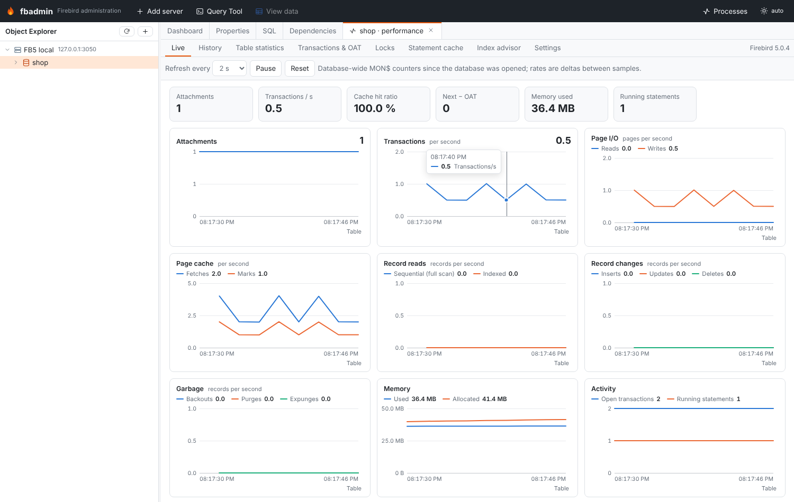
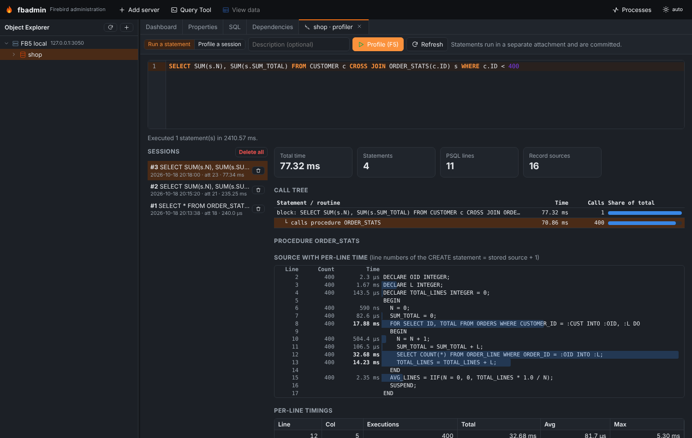
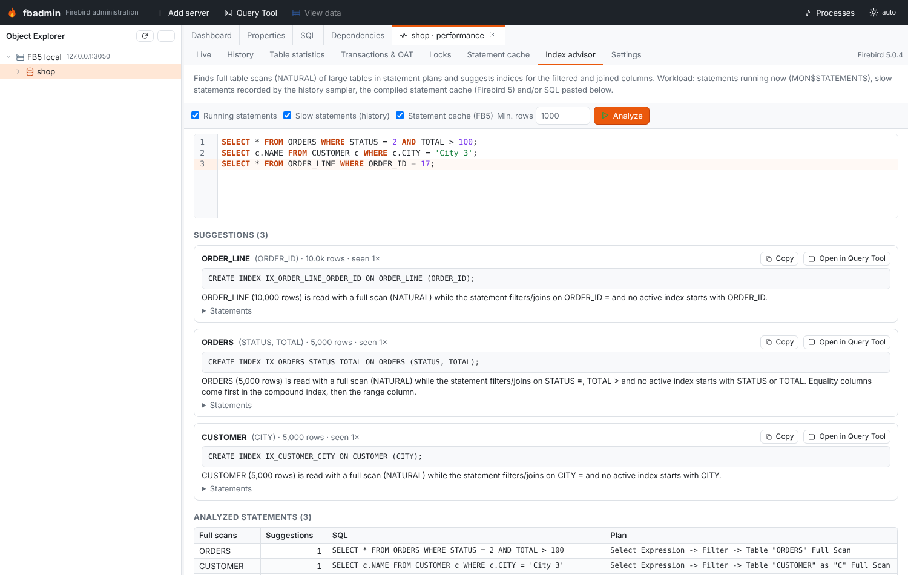

# Monitoring and performance

Milestone 0.7. Everything here reads the `MON$` monitoring tables (or the Firebird 5 profiler
tables) over a normal attachment. Nothing needs to be installed on the server.

Open it from a database's context menu (**Performance dashboard**, **Transactions & OAT**,
**Index advisor**, **Profiler**) or from the **Health** section of the database dashboard.



## Feature matrix

| Feature | Firebird 3 | Firebird 4 | Firebird 5 |
|---|---|---|---|
| Live charts, history, Prometheus metrics | ✓ | ✓ | ✓ |
| Table statistics (`MON$TABLE_STATS`) | ✓ (3.0.x has it) | ✓ | ✓ |
| Long-running transactions, OIT/OAT alerts, OAT holder | ✓ | ✓ | ✓ |
| Lock waits and likely blockers | ✓ | ✓ | ✓ |
| Lock manager settings (`RDB$CONFIG`) | – | ✓ | ✓ |
| Compiled statement cache (`MON$COMPILED_STATEMENTS`) | – | – | ✓ |
| Profiler (`RDB$PROFILER`, `PLG$PROF_*`) | – | – | ✓ |
| Index advisor | ✓ | ✓ | ✓ (plus the statement cache as a workload) |

Features are detected at runtime (by looking for the system tables or packages), not by version.
Where a feature is missing the UI says so instead of failing.

## Live dashboard

The **Live** tab polls `GET …/monitoring/snapshot` (1–30 s) and keeps the last 180 samples in
the browser. A snapshot is one query over `MON$DATABASE` joined with the database-level
`MON$IO_STATS`, `MON$RECORD_STATS` and `MON$MEMORY_USAGE`, plus counts of attachments,
transactions and running/stalled statements.

Counters are cumulative since the database was opened by its first attachment; the charts show
per-second deltas between consecutive samples. If the last attachment disconnects, the counters
reset: that interval is shown as a gap.

Charts: attachments, transactions/s (delta of `MON$NEXT_TRANSACTION`), page reads/writes,
page fetches/marks, sequential vs indexed record reads, inserts/updates/deletes, garbage
(backouts/purges/expunges), memory used/allocated, open transactions and running statements,
next transaction − OAT, and lock contention (record waits and update conflicts). The tiles above
show the latest values and the cache hit ratio (1 − reads/fetches).

The charts are inline SVG (no chart library): one y axis each, a crosshair tooltip that lists
every series, keyboard support (focus a chart, ←/→ move the crosshair) and a **Table** toggle
that shows the same numbers as a table. Colors are CSS variables in
`frontend/src/features/monitoring/monitoring.css` with separate light/dark values.

## History

Enable **Record history for this database** in the **History** tab. A background thread
(started from the FastAPI lifespan) takes a snapshot of every opted-in database every
*interval* seconds and stores it in `monitoring.sqlite` in the data directory
(`~/.fbadmin` or `FBADMIN_DATA_DIR`). Samples older than the retention are pruned.
Ranges: 1 h, 6 h, 24 h, 3 d, 7 d (down-sampled to 500 points).

While sampling, statements that have been running for longer than *slow_seconds* are recorded
(SQL text, explained plan, longest duration, how often seen). They are listed under the history
charts and feed the index advisor.

Settings (**Settings** sub-tab, or `PUT /api/monitoring/settings`); environment variables give
the defaults:

| Setting | Env | Default |
|---|---|---|
| `interval` (s, 0 = sampler off) | `FBADMIN_HISTORY_INTERVAL` | 60 |
| `retention_hours` | `FBADMIN_HISTORY_RETENTION_HOURS` | 168 |
| `slow_seconds` (0 = off) | `FBADMIN_HISTORY_SLOW_SECONDS` | 5 |
| `metrics_enabled` | `FBADMIN_METRICS` | off |

## Table statistics

Top tables by reads, sequential/indexed reads, inserts, updates, deletes, backouts, purges,
expunges, lock waits, conflicts or back-version reads, from `MON$TABLE_STATS` (stat group 0,
the whole database). System tables are hidden by default.

## Compiled statement cache (Firebird 5)

`MON$COMPILED_STATEMENTS`: SQL and PSQL routines in the cache with their explained plan, how
many `MON$STATEMENTS` currently use each one, and their I/O, record and memory counters. Click a
row to see the full SQL and plan.

## Transactions, OIT/OAT gaps and who holds the OAT

`GET …/monitoring/transactions?long_running=300&gap_warn=10000`

* gaps: next − OAT, OAT − OIT, next − OIT, next − OST;
* **OAT holder**: the transaction whose id equals `MON$OLDEST_ACTIVE` (or the oldest
  transaction that pins it), joined with its attachment (user, address, process, PID) and its
  statements. "Idle in transaction" is called out when no statement runs in it. You can
  disconnect the attachment from there;
* alerts: next − OAT above the threshold (critical at 10×), OAT − OIT above the threshold (with
  a sweep hint), and transactions older than *long_running* seconds. fbadmin's own metadata
  connection and system attachments (garbage collector, cache writer) are not reported.

The same alerts are shown in the **Health** section of the database dashboard.

## Locks and deadlocks

Firebird has no remote equivalent of `fb_lock_print`: the lock table lives in shared memory on
the server and is only readable by a local tool. The **Locks** tab shows what *is* available
remotely:

* statements waiting for a record lock: `MON$STATEMENTS` with `MON$RECORD_WAITS > 0` in their
  `MON$RECORD_STATS`, the transaction's lock timeout, and the tables they wait on
  (per-statement `MON$TABLE_STATS`);
* **likely blockers**: other live transactions that changed (inserted/updated/deleted/locked)
  records of the same tables (per-transaction `MON$TABLE_STATS`). Cancel the waiting statement or
  disconnect the blocker;
* statements with update conflicts, all running statements, lock timeouts of transactions;
* lock manager configuration from `RDB$CONFIG` (Firebird 4+): `DeadlockTimeout`, `LockMemSize`,
  `LockHashSlots`, `LockAcquireSpins`, …

Deadlocks are reported to the losing statement as an error (`deadlock` / `update conflicts with
concurrent update`); they are not kept in `MON$`. For lock-table level analysis run
`fb_lock_print -d <database>` on the server.

## Profiler (Firebird 5)



* **Run a statement**: fbadmin opens a separate attachment, calls
  `RDB$PROFILER.START_SESSION(description, NULL, NULL, NULL, 'DETAILED_REQUESTS')`, runs the
  statements (fetching all rows), then `RDB$PROFILER.FINISH_SESSION(TRUE)` and commits.
  `DETAILED_REQUESTS` is needed for per-request timings in `PLG$PROF_REQUESTS`.
* **Profile a session**: start profiling another attachment — for example a Query Tool tab (its
  attachment id is in the Query Tool status bar; fbadmin marks its own Query Tool attachments) —
  run statements there, then **Finish** (`FINISH_SESSION(TRUE, attachment_id)`).
* Procedures and functions have a **Profile…** item in their context menu.

The report shows:

* a **call tree** of statements: blocks, their child statements and the routines they call
  (from `PLG$PROF_STATEMENTS` parent ids and `PLG$PROF_REQUESTS` caller ids) with total time,
  call count and share of the total;
* **PSQL hot spots** (top lines across all routines) from `PLG$PROF_PSQL_STATS_VIEW`;
* for a routine: its **source with per-line counts and times** as a heat bar. Line numbers of
  the profiler are relative to the original `CREATE` statement while `RDB$…_SOURCE` starts after
  `AS`; fbadmin estimates the offset by matching the profiled (line, column) pairs to token
  starts in the stored source;
* for a statement: its **record sources** (access paths) with open/fetch counters and times
  from `PLG$PROF_RECORD_SOURCE_STATS_VIEW`.

Sessions can be deleted one by one or all at once. On Firebird 3/4 the tab explains that the
profiler needs Firebird 5.

## Index advisor



Workload sources (any combination): statements running now (`MON$STATEMENTS` with their explained
plan), slow statements recorded by the history sampler, the compiled statement cache (Firebird 5)
and SQL pasted in the editor (prepared to get its plan; nothing is executed).

For each statement:

1. the plan is parsed for full scans: `Table "T" as "A" Full Scan` in explained plans, or
   `PLAN (A NATURAL)` in legacy plans;
2. the SQL is parsed (regular expressions over the text with string literals blanked) for table
   aliases and `WHERE` / `JOIN … ON` predicates: equality (`=`, `IN`, `IS`), range (`<`, `>`,
   `BETWEEN`, `STARTING WITH`, `LIKE 'abc%'`), function-wrapped (`UPPER(col) = …`) and
   non-sargable (`<>`, `NOT …`, `CONTAINING`, `LIKE '%x'`);
3. the scanned table's size is estimated with a bounded `COUNT(*)` (capped at 1,000,000 rows);
   tables below *min rows* (default 1000) are skipped with a note;
4. if no active index starts with a filtered/joined column, a `CREATE INDEX` is suggested:
   equality columns first, then one range column (at most three columns); `UPPER/LOWER/TRIM(col)`
   predicates get a `COMPUTED BY` expression index;
5. if an index exists but the table is still scanned, a note lists possible causes (stale
   selectivity → `SET STATISTICS INDEX`, type mismatch, `OR`, low selectivity).

Suggestions are ranked by total observed time, then occurrences and table size. Each has the DDL
(copy / open in the Query Tool), the reasoning and the statements it came from. This is a
heuristic: check the new plan after creating an index.

## Prometheus exporter

Disabled by default. Enable with `FBADMIN_METRICS=1` or in **Settings**. Then `GET /metrics`
returns the text exposition format (0.0.4) for every database with history enabled, or for every
registered database with `/metrics?all=1`. Set `FBADMIN_METRICS_TOKEN` to require
`Authorization: Bearer <token>`.

Metrics (labels `server`, `host`, `database`): `fbadmin_database_up`,
`fbadmin_scrape_duration_seconds`, gauges `firebird_attachments`, `firebird_transactions`,
`firebird_statements_active`, `firebird_statements_stalled`, `firebird_oldest_transaction`,
`firebird_oldest_active`, `firebird_oldest_snapshot`, `firebird_memory_used_bytes`,
`firebird_memory_allocated_bytes`, and counters `firebird_next_transaction_total`,
`firebird_page_{reads,writes,fetches,marks}_total`,
`firebird_record_{seq_reads,idx_reads,inserts,updates,deletes,backouts,purges,expunges,waits,conflicts}_total`.

```yaml
scrape_configs:
  - job_name: firebird
    metrics_path: /metrics
    static_configs: [{ targets: ["fbadmin-host:5050"] }]
```

Note that the counters reset when the database is closed by its last attachment (Prometheus
handles counter resets in `rate()`).

## API summary

All under `/api/servers/{sid}/databases/{dbid}/monitoring` unless noted.

| Method | Path | |
|---|---|---|
| GET | `/features` | what this server supports |
| GET | `/snapshot` | counters + gauges |
| GET | `/tables?order_by=&limit=&include_system=` | table statistics |
| GET | `/compiled?search=&limit=` | compiled statement cache |
| GET | `/transactions?long_running=&gap_warn=` | gaps, OAT holders, alerts |
| GET | `/locks` | lock waits, blockers, config |
| GET | `/history?hours=&max_points=` | stored samples with rates |
| PUT | `/history/tracking` `{enabled}` | opt a database in/out |
| POST | `/history/sample` | sample now |
| DELETE | `/history` | delete stored samples |
| GET | `/history/slow` | slow statement log |
| GET/PUT | `/api/monitoring/settings` | sampler/exporter settings |
| GET | `/profiler` | availability, sessions, attachments |
| POST | `/profiler/run` `{sql, description}` | profile statements |
| POST | `/profiler/start` / `/profiler/finish` `{attachment_id}` | profile another attachment |
| GET/DELETE | `/profiler/{id}` | report / delete a session (`DELETE /profiler` = all) |
| POST | `/advisor` `{sources, sql, min_rows}` | index suggestions |
| GET | `/metrics` (root) | Prometheus exporter |
