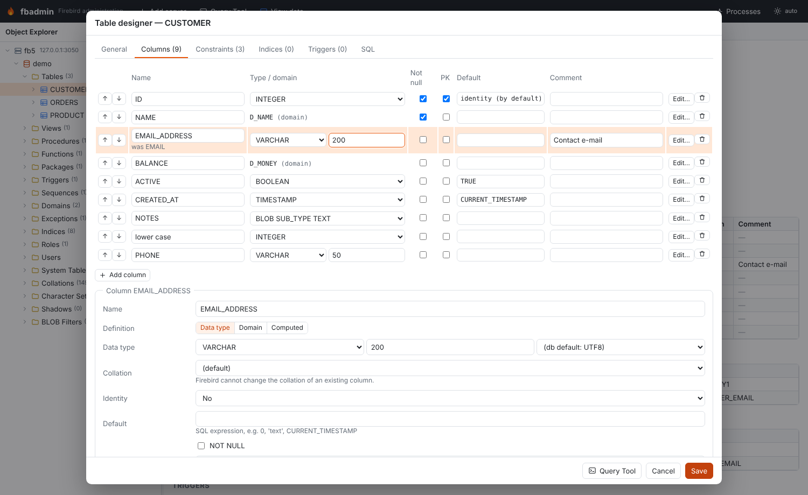
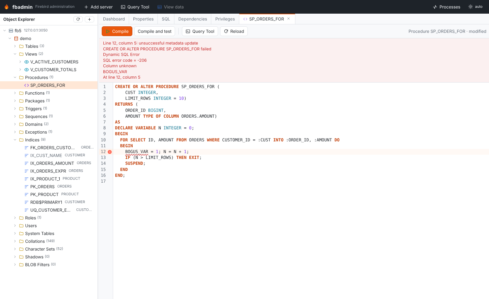
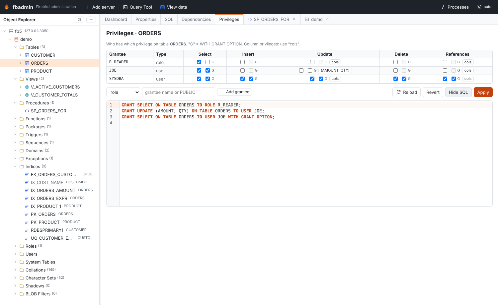
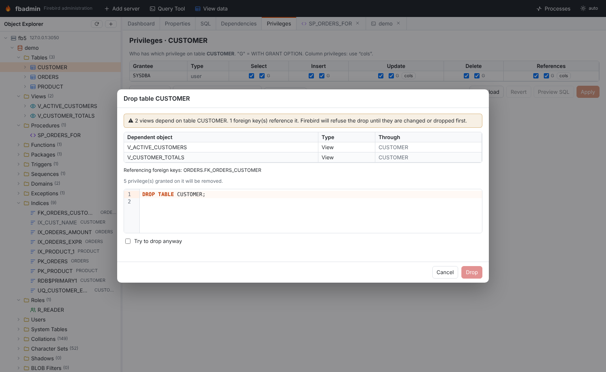

# Object dialogs

fbadmin creates and changes database objects through pgAdmin-style dialogs. Every dialog
has form tabs (General, Columns, Definition, …) and a **SQL** tab that shows the exact DDL
that will run. **Create** / **Save** runs that script in autocommit mode and refreshes the
object explorer; **Query Tool** opens the script in a Query Tool instead, so you can edit
or run it by hand.

The DDL is generated on the server (`POST /api/servers/{sid}/databases/{db}/ddl`) from the
dialog's form state. When you edit an existing object, the dialog sends the original
definition too, and the generator emits an `ALTER` script with only the differences. It
never drops and re-creates a table. When Firebird cannot make a change in place, the SQL
tab shows a ⚠ warning and leaves that change out.

## Where to find them

| Right-click on… | Menu entries |
|---|---|
| a folder (Tables, Views, …) | **Create table / view / procedure / … …**, and for routines **New … in PSQL editor** |
| a table | **Table designer…**, **Add column…**, **Add constraint…**, **Add index…**, **Create trigger…**, **Comments…**, **Rename…**, **Drop table…** |
| a column (expand a table) | **Edit column…**, **Rename column…**, **Comment…**, **Drop column…** |
| a procedure, function, trigger or package | **… dialog…** (structured editor), **Edit source (PSQL editor)** |
| an index | **Edit index…**, **Recompute selectivity**, Activate / deactivate |
| any other object | **Edit …**, **Comments…**, **Rename…**, **Drop …** |

Selecting a table, view, routine, package, sequence, exception, role or user also shows a
**Privileges** tab next to Properties / SQL / Dependencies.

## Table designer

The table designer works for new tables and for existing ones.

- **General**: the name, the table type (persistent, or global temporary with
  `ON COMMIT PRESERVE ROWS` / `ON COMMIT DELETE ROWS`), an `EXTERNAL FILE`,
  `SQL SECURITY DEFINER/INVOKER` (Firebird 4+) and the comment.
- **Columns**: add, drop and rename columns, reorder them with ↑/↓, change type, NOT NULL,
  primary key membership, default and comment inline. **Edit…** opens the column editor
  below the grid. It covers the data type or a domain or `COMPUTED BY`, the collation,
  `GENERATED BY DEFAULT/ALWAYS AS IDENTITY` (start, increment, restart), the default,
  NOT NULL and the comment.
- **Constraints**: primary key, unique, foreign key and check constraints. A foreign key
  has a referenced-table picker, a referenced-column picker (it defaults to the referenced
  table's primary key) and ON UPDATE / ON DELETE rules. Any key can name its index
  (`USING [DESC] INDEX`).
- **Indices**: unique, descending, column or expression (`COMPUTED BY`) indices,
  partial indices (`WHERE`, Firebird 5), active/inactive.
- **Triggers** (existing tables): activate, deactivate or drop. **Edit source** opens the
  PSQL editor.

For an existing table, the generated script follows this order. Trigger drops come first,
then dropped or changed constraints (foreign keys first), then dropped or changed indices.
After those come column drops, renames (`ALTER COLUMN … TO`), alterations (`TYPE`,
`SET/DROP DEFAULT`, `SET/DROP NOT NULL`, `COMPUTED BY`, identity options), new columns and
`ALTER COLUMN … POSITION`. New constraints, indices, index and trigger activation,
`SQL SECURITY` and finally the comments close the script.

Firebird limits, and how the designer deals with them:

| Change | What happens |
|---|---|
| Rename a column that is part of a PK / UNIQUE / FK / CHECK constraint | Firebird refuses the rename while the constraint exists. The script drops the constraint, renames the column and re-adds the constraint (CHECK conditions are rewritten to the new name). Indices follow a rename automatically. |
| Rename a column used by a view, procedure, trigger or computed column | Firebird refuses; the error is shown. Change or drop the dependent object first. |
| Change a column's collation | Not possible in place; ⚠ warning (use a domain, or add a new column and copy the data). |
| Make an existing column an identity column | Not possible; ⚠ warning. Removing identity (`DROP IDENTITY`), `SET GENERATED`, `SET INCREMENT BY` need Firebird 4; `RESTART WITH` works on all versions. |
| Computed ↔ stored column | The column is dropped and re-added, with a ⚠ warning (its data is lost). |
| Rename the table, change GTT/persistent type or the external file | Not possible; ⚠ warning. |
| Change an index definition | Firebird cannot alter an index, so it is dropped and created again. |

**Add column…**, **Edit column…** and **Add constraint…** open small dialogs. They use the
same generator on a copy of the table definition, so the SQL tab shows only the
statements for that one change. The column dialog also has a **Position** field
(`ALTER COLUMN … POSITION`).

## Index dialog

The index dialog sets the name, the table, the columns (in order) or an expression, unique,
descending, active and the comment. It also sets a partial index condition (`WHERE`), on
Firebird 5 only; the field is disabled on older servers. For an existing index it can
deactivate or activate the index, or **Recompute (SET STATISTICS)** its selectivity. If you
change the definition, the index is dropped and created again. An index that enforces a
constraint can only be activated, recomputed or commented on; change its definition in the
table designer.

## View editor

The view editor has three fields: an optional column list, the SELECT (in the SQL editor)
and **WITH CHECK OPTION**. Saving runs `CREATE OR ALTER VIEW`. If other objects depend on
the view, the Definition tab says so. Save then asks for a second click, because changing
the result columns can fail or invalidate them.

## Procedures, functions, triggers and packages

There are two ways to edit routines.

1. **Dialogs** (structured):
   - **Procedures and functions**: name, input and output parameters (type, default,
     NOT NULL, `TYPE OF …`, comment), RETURNS and DETERMINISTIC, and SQL SECURITY. The
     body is either PSQL or **External (UDR)**:
     `EXTERNAL NAME 'module!entry' ENGINE UDR [AS '…']`.
   - **Triggers**: table or view DML triggers (BEFORE/AFTER, INSERT/UPDATE/DELETE),
     database triggers (ON CONNECT, …) and DDL triggers. Each has a position, an active
     flag and SQL SECURITY.
   - **Packages**: the header and body editors, plus SQL SECURITY.

   Parameter comments are saved with `COMMENT ON PARAMETER`.
2. **PSQL editor** (a workspace tab): edits the full `CREATE OR ALTER` source in the SQL
   editor.
   - **Compile** (Ctrl+Enter / F5) runs the source. If it fails, the error is mapped to its
     line and column, underlined in the editor and reported as "Line N, column M: …".
   - **Compile and test** compiles, then opens a Query Tool with an `EXECUTE PROCEDURE` /
     `SELECT` script that has parameter markers.
   - **Reload** reads the source back from the database.

   

Before an existing object is altered, both editors check `RDB$DEPENDENCIES`. If other
objects depend on it, they show which ones and ask for a second click
("Compile anyway" / "Save anyway").

## Sequences, domains, exceptions, roles and collations

- **Sequence**: start and increment when you create it. For an existing sequence,
  increment, `RESTART WITH` and **Set current value** (`SET GENERATOR … TO`).
- **Domain**: data type, collation, default, NOT NULL, CHECK (`VALUE …`) and comment.
  Changes use `ALTER DOMAIN` (`TO` for a rename, `TYPE`, `SET/DROP DEFAULT`,
  `SET/DROP NOT NULL`, `DROP CONSTRAINT` / `ADD CONSTRAINT CHECK`).
- **Exception**: message (`@1`, `@2` placeholders) and comment, through
  `CREATE OR ALTER EXCEPTION`.
- **Role**: members (`GRANT role TO USER/ROLE … [WITH ADMIN OPTION]`, revoke) and, on
  Firebird 4+, system privileges (`SET SYSTEM PRIVILEGES TO …` /
  `DROP SYSTEM PRIVILEGES`).
- **Collation**: `CREATE COLLATION … FOR charset FROM base | FROM EXTERNAL ('…')`,
  `PAD SPACE`, case and accent sensitivity, and ICU attributes such as `NUMERIC-SORT=1`.
  A collation cannot be altered later; only its comment can change.

## Privileges (grants editor)

The **Privileges** tab reads `RDB$USER_PRIVILEGES` and works from either side.

- **Per object** (tables, views, procedures, functions, packages, sequences, exceptions,
  roles): one row per grantee (user, role, procedure, function, package, trigger, view or
  PUBLIC). There is one column per applicable privilege: SELECT, INSERT, UPDATE, DELETE,
  REFERENCES, EXECUTE, USAGE, or MEMBER for roles.
  - **G** sets WITH GRANT OPTION (WITH ADMIN OPTION for role membership).
  - **cols** grants UPDATE or REFERENCES on single columns.
- **Per user or role**: what the user or role holds, one row per object. Use the switch
  on a role to see either its members or the privileges it holds. DDL privileges such as
  `CREATE TABLE` are listed read-only.

**Preview SQL** shows the GRANT / REVOKE statements. These are minimal: changes are grouped
per grantee, and removing only the grant option produces `REVOKE GRANT OPTION FOR …`.
**Apply** runs them.

## Rename

| Object | Supported | How |
|---|---|---|
| Column | yes | `ALTER TABLE … ALTER COLUMN … TO` |
| Domain | yes | `ALTER DOMAIN … TO` |
| Index | yes | Re-created under the new name (`DROP INDEX` + `CREATE INDEX`); not possible for indices that enforce constraints |
| Table, view, sequence, procedure, function, package, trigger, exception, role, collation | no | Firebird has no rename. The Rename dialog says so and suggests a workaround (for sequences: create a new one and `SET GENERATOR` to the current value) |

## Drop with dependency preview

**Drop …** first shows what would break. Dependents are listed transitively (a view, then
a view on that view, then a procedure that reads it), along with:

- foreign keys in other tables that reference the table,
- columns that use a domain,
- the constraints and indices a column belongs to,
- the privileges that will be removed.

If anything depends on the object, the **Drop** button stays disabled until you tick
**Try to drop anyway**.

## Comments

**Comments…** edits `COMMENT ON` for an object. For a table or view it also edits every
column, and for a procedure or function every parameter. It works for all object types,
including indices, users, collations, character sets and BLOB filters. Clearing a comment
generates `COMMENT ON … IS NULL`.

## SQL SECURITY (Firebird 4+)

Tables, triggers, procedures, functions and packages show **SQL security** in Properties.
Their extracted DDL includes `SQL SECURITY DEFINER/INVOKER`, and the dialogs can set or
drop it (`ALTER TABLE … ALTER SQL SECURITY …` / `DROP SQL SECURITY`). On Firebird 3 the
option is disabled, and the generator leaves it out with a warning.

## Collations, character sets, shadows and BLOB filters

The object explorer has four more folders.

- **Collations**: every collation with its character set, base collation and system flag.
  User collations have DDL and can be created, commented on and dropped.
- **Character Sets**: bytes per character, default collation and the collations of each
  character set. Read-only, except for comments.
- **Shadows**: the shadow number, AUTO/MANUAL, CONDITIONAL and the files, with
  `CREATE SHADOW` DDL. Read-only.
- **BLOB Filters**: input/output subtypes, module and entry point, with
  `DECLARE FILTER` DDL. Read-only.

The Properties tab shows a **System flag** for these objects and for sequences, domains,
exceptions, roles, routines, triggers and indices.

## API

| Method | Path (under `/api/servers/{sid}/databases/{db}`) | Purpose |
|---|---|---|
| GET | `/designer/lookups` | engine version, tables, views, domains, charsets, collations, system privileges |
| GET | `/designer/{otype}/{name}` | editable spec of an existing object |
| GET | `/designer/relations/{table}` | columns and PK/UNIQUE keys (FK pickers) |
| GET | `/designer/comments/{otype}/{name}` | object, column and parameter comments |
| POST | `/ddl` | `{kind, spec, original}` → `{sql, statements, warnings}`; nothing is executed |
| GET | `/objects/{otype}/{name}/drop-preview[?column=]` | DROP statement and transitive dependents |
| GET | `/privileges?object=…` or `?grantee=…` | decoded `RDB$USER_PRIVILEGES` rows |
| GET | `/privileges/grantees`, `/privileges/objects` | pickers for the grants editor |

`kind` is one of `table`, `index`, `view`, `procedure`, `function`, `trigger`, `package`,
`sequence`, `domain`, `exception`, `role`, `collation`, `comments`, `rename`, `grants` or
`drop`. The generator lives in `backend/fbadmin/metadata/ddlgen.py`, and
`backend/tests/test_objects_03.py` checks the generated scripts against live Firebird 3,
4 and 5 servers.
