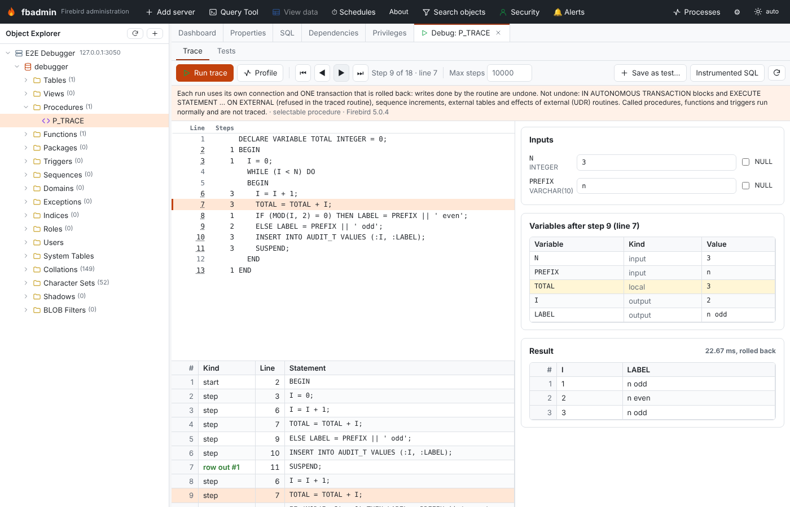

# PSQL debugging help

Milestone 1.2. Firebird has no debugger API: you cannot pause a procedure, look at its variables
and step to the next line. fbadmin gets as close as it honestly can with three tools on one screen:

* **Trace** — runs an instrumented copy of a procedure, function or `EXECUTE BLOCK` that records
  the line and the variables after every statement. You then step back and forward through the
  recorded steps like in a debugger (it is a replay, not a live session).
* **Profile** — runs the routine itself under the Firebird 5 profiler and shows hit counts and time
  per source line.
* **Tests** — saved test cases per routine (inputs plus the expected rows or error), run one by one
  or all at once, each in a transaction that is rolled back.

Open it from the context menu of a procedure or function (**Debug / trace…**, **Tests…**) or of a
database (**Debug EXECUTE BLOCK…**, **PSQL tests…**).



## Nothing is committed

Every run (trace, profile, test) uses its own connection and **one transaction that is rolled back**
at the end. Inserts, updates, deletes and DDL done by the routine (or by the procedures, functions
and triggers it calls) are undone.

A rollback cannot undo everything:

| Effect | What fbadmin does |
|---|---|
| `IN AUTONOMOUS TRANSACTION DO ...` in the traced routine | refused: the routine cannot be traced |
| `EXECUTE STATEMENT ... ON EXTERNAL` / `WITH AUTONOMOUS TRANSACTION` in the traced routine | refused |
| the same in a procedure, function or trigger the routine depends on | warning (found through `RDB$DEPENDENCIES`) |
| sequences (`GEN_ID`, `NEXT VALUE FOR`) | warning: increments are not transactional |
| writes to external tables | warning |
| external (UDR) routines that are called | warning: effects outside the database are not undone |
| `POST_EVENT` | events are only delivered on commit, so they are never delivered |

On a server registered as **read-only** the trace, profile and test endpoints (all `POST`) are
refused by fbadmin's read-only guard, like every other request that is not a plain query; the
source and the saved tests can still be viewed.

## Trace runs

Pick the input values (text, or tick **NULL**) and press **Run trace**. Values are passed as
string literals and converted by Firebird, exactly as `SELECT * FROM P('5', '2024-01-31')` would.

The screen shows:

* **Source** with line numbers. *Steps* is how many recorded steps are on that line; the current
  step's line is highlighted, an error line is red. Click an underlined line number to jump to the
  next step on that line ("run to line").
* **Step controls**: first / back / forward / last, and **Max steps** (default 10 000, at most
  100 000). A run that records more steps is stopped there, so an endless loop does not hang.
* **Variables** after the current step: inputs, local variables, output parameters (and a
  function's result). Values that changed in this step are highlighted. BLOBs are shown as their
  size, long strings are cut (see below).
* **Steps**: every recorded step (kind, line, statement). The list is keyboard operable
  (arrow keys, Page Up/Down, Home/End).
* **Result**: the rows (selectable procedures), the output parameters (executable procedures) or
  the returned value (functions), or the error.

Step kinds: *start* (inputs and initial values), *step* (after a statement; before `LEAVE`,
`BREAK`, `CONTINUE` and `EXCEPTION`), *fetch* (a `FOR SELECT` / `FOR EXECUTE STATEMENT` loop
fetched a row into its variables), *row out* (`SUSPEND`), *caught error* (a `WHEN` handler was
entered: shows GDSCODE, SQLSTATE and, on Firebird 4+, the error message), *end*.

When the routine fails, the error message is shown with `At block line: N` rewritten as
`At source line N`, the line is marked, and **Show the last step** jumps to the last recorded state.

**Save as test…** turns the inputs and the result of the last trace (rows or error) into a test case.

### How it works

fbadmin rewrites the routine into an `EXECUTE BLOCK` and runs that instead of the routine:

```sql
EXECUTE BLOCK RETURNS (FBT$K SMALLINT, FBT$L INTEGER, <the routine's outputs>, FBT$1 <type of input 1>, ...)
AS DECLARE N INTEGER = '3'; <the routine's own declarations, unchanged>
BEGIN BEGIN FBT$K=0;FBT$L=2;FBT$1=N;...;SUSPEND;
  I = 0; FBT$K=1;FBT$L=3;FBT$2=I;SUSPEND;
  WHILE (I < N) DO
  ...
```

* Input parameters become local variables initialised with the values you typed.
* After every statement a tracing statement sets the step kind, the line in the original source
  and the variables the statement mentions (a statement can only change variables it names), then
  `SUSPEND`s that row to fbadmin. Entry, handler and end steps copy every variable.
* Single statements in `IF ... THEN`, `ELSE`, `WHILE ... DO`, `FOR ... DO` and `WHEN ... DO` are
  wrapped in `BEGIN ... END` so the extra statement stays inside the branch:
  `IF (x) THEN stmt;` becomes `IF (x) THEN BEGIN stmt; <trace> END`.
* `SUSPEND` emits the output row, `EXIT` and a function's `RETURN expr` emit the final row first
  (`RETURN expr` becomes `FBT$R = expr; <final row> EXIT;`).
* Statements are never removed or reordered, and every insertion stays on the line of its
  statement, so line numbers in the block are the line numbers of the routine's stored source.
* On Firebird 4 and newer the body is wrapped in a `WHEN ANY` handler that turns an escaping error
  into a last row (with `RDB$ERROR(MESSAGE)`), so rows can be fetched in batches. Firebird 3 has no
  `RDB$ERROR`: there fbadmin fetches one row per round trip so the steps before the error are not
  lost (slower: roughly 1 ms per step).

The trace is collected as result rows, not in context variables, so there is no 1000-variable
(`RDB$SET_CONTEXT`) or 255-character limit; the cap is **Max steps**.

Use **Instrumented SQL** to see exactly what was run.

### What is and isn't supported

Supported: procedures (selectable and executable), functions and anonymous `EXECUTE BLOCK`s
(their `= ?` inputs are filled from the inputs form); nested `BEGIN ... END`; `IF/ELSE` chains with
or without `BEGIN`; `WHILE`; labels with `LEAVE`/`CONTINUE`/`BREAK`; `FOR SELECT ... INTO ... DO`
(also `AS CURSOR` with `WHERE CURRENT OF`); `FOR EXECUTE STATEMENT ... DO`; `DECLARE ... CURSOR`
with `OPEN`/`FETCH`/`CLOSE`; sub-procedures and sub-functions (Firebird 3+); `WHEN ... DO` handlers
(any condition list), `EXCEPTION` with and without re-raise; `SUSPEND`, `EXIT`, `RETURN`; `CASE`
expressions; `MERGE`; `ROW_COUNT`, `GDSCODE`, `SQLSTATE` (tracing statements do not reset them);
comments, `'strings'`, `q'{...}'` strings and `"quoted"` names containing keywords and semicolons.

Not traced (they run normally): sub-procedure and sub-function bodies, called procedures and
functions, triggers fired by the routine's DML, dynamic SQL of `EXECUTE STATEMENT`, and fields of
`AS CURSOR` cursors (only variables are shown).

Not supported: triggers and packaged routines (use a test or the profiler on a caller), legacy
UDFs, external (UDR) routines (no PSQL to trace — they can still be tested), and `IN AUTONOMOUS
TRANSACTION` / `ON EXTERNAL` in the traced routine. Source the parser does not understand is
refused with the line and the reason rather than guessed.

Differences from running the routine itself:

* The block runs with **your** privileges. A routine with `SQL SECURITY DEFINER` (or one that was
  granted privileges the caller lacks) may behave differently; tests and profiled runs call the
  routine itself and are not affected.
* `NOT NULL` and domain `CHECK` constraints of output parameters are not enforced in a trace (trace
  rows are sent before the outputs are set). Input parameters and local variables keep their
  constraints. The screen warns when this applies.
* Every trace row is a round trip to fbadmin, so a trace is much slower than the routine itself.
  Use **Profile** for timings.
* Very long strings (over 4000 bytes) are traced as their first 1000 characters and BLOBs as their
  size, so one trace row stays below Firebird's 64 KB message limit. On Firebird 3 an instrumented
  block over 64 KB is refused.

## Per-line timings (Firebird 5)

**Profile** calls the routine itself (`SELECT * FROM P(...)`, `EXECUTE PROCEDURE P(...)` or
`SELECT F(...) FROM RDB$DATABASE`) between `RDB$PROFILER.START_SESSION` and
`FINISH_SESSION(TRUE)`, rolls the call back, and shows *Count* and *Time* columns next to the
source, with the hottest lines marked. Profiler line numbers are relative to the `CREATE`
statement; fbadmin maps them to the stored source (the same mapping as the Profiler screen).
The profile also stays available under **Monitoring → Profiler**.

On Firebird 3 and 4 the button explains that per-line timings need Firebird 5.

## Tests

The **Tests** view lists the test cases of the routine (or, from the database menu, of the whole
database). A test case has a name, input values and the expected outcome:

* **Rows** — a JSON list of rows, each a list of values: `[[1, "a"], [2, null]]`. A function
  returns one row with its result (`[[120]]`), an executable procedure one row of output
  parameters. Values are compared as text after trimming trailing blanks (so `CHAR` padding does
  not matter), numbers numerically (`"3.50"` equals `3.5`) and timestamps with or without the `T`.
* **An error** — the error message must contain the given text (empty: any error).

**Run tests of P**, **Run all tests of this database** and the ▷ button of a row call the routine
itself (not the instrumented copy), one transaction per test, rolled back. Failures list the
differences (`row 1, LABEL: expected 'x even', got 'x odd'`).

Test cases are stored by fbadmin in `psql_tests.json` in its data directory (`~/.fbadmin` or
`FBADMIN_DATA_DIR`, file mode 0600), per registered database, not in the database itself.

## API

All under `/api/servers/{server_id}/databases/{db_id}/debug`:

| Method and path | What it does |
|---|---|
| `GET /routine?otype=procedures&name=P` | parameters, source, kind, traceable or why not, warnings |
| `POST /parse` `{sql}` | the same for an `EXECUTE BLOCK` |
| `POST /trace` `{otype, name or sql, inputs, watch?, max_steps?}` | trace run |
| `POST /run` | call the routine itself (rolled back) |
| `POST /profile` | profiled call (Firebird 5) |
| `GET/POST /tests`, `PUT/DELETE /tests/{id}` | test cases |
| `POST /tests/run` `{ids?, otype?, routine?}` | run tests; returns pass/fail and differences |

`watch` limits the traced variables (all by default), which keeps the block small.
