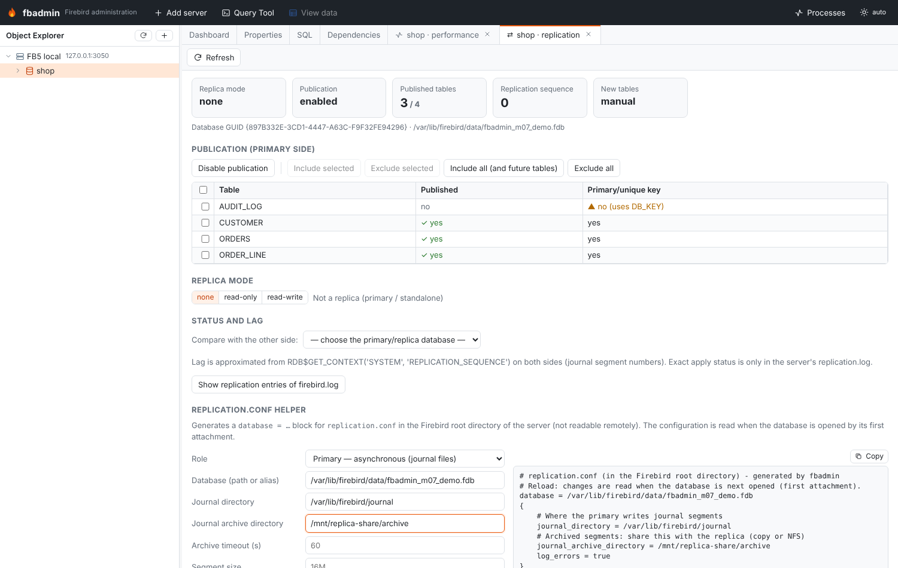

# Replication and high availability

Milestone 0.8. Firebird 4.0 introduced built-in logical replication: the primary records changes
of *published* tables in journal segments (asynchronous) or sends them straight to replicas
(synchronous); a replica database in *replica mode* applies them. fbadmin manages the parts that
are reachable over SQL and the services API and helps write `replication.conf`, which lives on
the server.

Open **Replication** from a database's context menu. On Firebird 3 the tab says replication is not
available (the `replication.conf` helper still works for planning).



## Setup wizard

**Set up a replica…** (database context menu, or the Replication tab) sets up a primary and its
replica end to end and then checks that changes arrive. It runs in five steps:

1. **The replica**: the replica server (registered in fbadmin) and the file there, asynchronous or
   synchronous replication, all tables or chosen ones, the directories. **Check the plan** lists what
   blocks the setup (errors) and what to know (warnings), for example tables without a primary key, other
   applications attached, or a replica file that exists already.
2. **replication.conf of the primary server**: the block to add, with the commands that create the journal
   and archive directories. fbadmin can write the block itself (see below); otherwise copy or download it.
   The block is read when the database is opened, so the database must be reopened afterwards. fbadmin
   closes its own connections; other applications must disconnect.
3. **Copy and replica**, a background job:
   * asynchronous: enable publication, include the tables, check that the primary writes its journal (its
     replication sequence moves after a change; if it doesn't, the block isn't active and the setup stops
     before anything is copied), make the copy, restore it on the replica server, switch it to read-only
     replica mode and register it in fbadmin;
   * synchronous: make the copy first, with publication still off, then do the same on the replica side,
     and enable publication last. Changes made by other applications between the copy and the start of
     publication don't reach the replica; the plan warns when other applications are attached.
4. **replication.conf of the replica server** (asynchronous): the replica's block, with the primary's
   GUID as `source_guid`. The replica server reads replica blocks only at startup, so restart it.
5. **Check that changes arrive**: fbadmin inserts a row into `FBADMIN_REPLICATION_CHECK` on the primary
   and waits until it is on the replica. The Replication tab has the same check (**Send a check row**,
   under *Status and lag*) for later.

### How the replica is made

The replica is a **physical copy**: `nbackup -B 0` on the primary, restored on the replica server with
`nbackup -R -SEQ` (both through the Services API). This copy keeps the primary's GUID, record formats and
replication sequence, so the replica applies exactly the journal segments written after the copy. No change
is lost or applied twice, even while applications keep writing.

fbadmin doesn't make replicas with gbak. A gbak restore can lay a table's fields out differently, and the
replica applies changes by physical record format, so the replica stops with *"Record format with length
… is not found for table …"*. A gbak copy also starts over at the oldest archived segment, and a DDL
statement among those segments stops the replica (*"Table … already exists"*).

The copy has to reach the replica server:

* **shared**: both servers see the copy directory (the same server, or shared storage). Give the
  directory as each server sees it;
* **manual**: the job stops after the copy and shows the file. Copy it to the replica server, enter
  where it is there, and **Restore and continue** finishes the setup.

The copy file isn't deleted afterwards (fbadmin can't delete files on the server).

Both servers need the same Firebird major version (a physical copy). The replica's own publication is
turned off before it becomes a replica, so it doesn't cascade.

### Writing replication.conf

fbadmin writes a block into an existing file named `replication.conf` that it can reach: a Firebird on
the same machine, or a mounted volume (Docker, Kubernetes). It replaces the block of the same database or
appends it, rewrites the file in place (owner and permissions stay, and a bind-mounted file keeps working),
and keeps the old file as `replication.conf.<timestamp>.bak`. In server mode only administrators can do
this, and only for the files listed in `FBADMIN_REPLICATION_CONF` (separated by the system's path
separator or commas).

A wrong line in `replication.conf` turns replication off for every database of that server (Firebird
reports an "illegal line" in `replication.log`). fbadmin quotes values that Firebird would misread, such as
a GUID in braces, and refuses paths with braces, quotes or line breaks.

### Tested

`backend/tests/test_replication_setup.py` and `e2e/tests/replication-setup.spec.ts` run on two Firebird
servers with a shared volume (`scripts/replication-test-servers.sh`, Firebird 4 and 5 in CI). fbadmin
writes both replication.conf files, and the tests cover the asynchronous setup with a shared directory, the
manual transfer and the synchronous setup, ending with the check row arriving on the replica.

## Publication (primary)

| Action | SQL |
|---|---|
| Enable / disable publication | `ALTER DATABASE ENABLE PUBLICATION` / `ALTER DATABASE DISABLE PUBLICATION` |
| Include tables | `ALTER DATABASE INCLUDE TABLE A, B TO PUBLICATION` |
| Exclude tables | `ALTER DATABASE EXCLUDE TABLE A FROM PUBLICATION` |
| Include all (also tables created later) | `ALTER DATABASE INCLUDE ALL TO PUBLICATION` |
| Exclude all | `ALTER DATABASE EXCLUDE ALL FROM PUBLICATION` |

The tab lists `RDB$PUBLICATIONS` (the default publication `RDB$DEFAULT`: active flag and
auto-enable, which is set by `INCLUDE ALL`) and all user tables with their published state from
`RDB$PUBLICATION_TABLES`. Warnings:

* publication enabled but no table included (nothing is replicated);
* published tables without a primary or unique key: they are replicated by `RDB$DB_KEY`, so
  updates and deletes may not find the row on the replica;
* a replica that also publishes (cascading replication).

## Replica mode

`MON$DATABASE.MON$REPLICA_MODE`: `none` (normal database), `read_only` (only the replication
applier may write) or `read_write`.

There is no SQL statement for it; fbadmin uses the services API like `gfix -replica <mode>`
(`isc_action_svc_properties` with `isc_spb_prp_replica_mode`). The engine needs exclusive access:
fbadmin closes its own connections to the database (metadata and Query Tool tabs) first and
refuses, listing them, if other applications are attached.

## Status and lag

* `RDB$GET_CONTEXT('SYSTEM', 'REPLICATION_SEQUENCE')`: the current journal segment sequence.
* Pick the other side (another registered database, possibly on another server) under **Status
  and lag** to compare: fbadmin shows the peer's replica mode, sequence and GUID and the
  difference of sequences as *segments behind* — an approximation of the lag.
* **Show replication entries of firebird.log**: entries mentioning replication/journal/segment
  read via the services API (`getLog`).

What is not reachable remotely: `replication.conf` itself, the journal and archive directories,
and `replication.log` (where the replica's applier writes its progress and errors). Firebird does
not expose replication settings through `RDB$CONFIG`. Monitor those on the server (file system,
log shipping), or use fbadmin's history/metrics for the database-level counters.

## replication.conf helper

A form that builds the `database = … { … }` block to paste into `replication.conf` in the
Firebird root directory. The configuration is read when the database is opened by its first
attachment.

Roles:

* **Primary — asynchronous**: `journal_directory` (required), `journal_archive_directory`
  (required; the replica reads archived segments from here, so share it by NFS/copy),
  `journal_file_prefix`, `journal_segment_size`, `journal_segment_count`,
  `journal_archive_command`, `journal_archive_timeout`, `include_filter`, `exclude_filter`;
* **Primary — synchronous**: `sync_replica = user:password@host:/path/replica.fdb`;
* **Replica**: `journal_source_directory` (required), `source_guid`, `apply_idle_timeout`,
  `apply_error_timeout`;
* common: `verbose_logging`, `log_errors`, `report_errors`, `disable_on_error`,
  `cascade_replication`.

Example output:

```
database = /data/main.fdb
{
    # Where the primary writes journal segments
    journal_directory = /var/lib/firebird/journal
    # Archived segments: share this with the replica (copy or NFS)
    journal_archive_directory = /mnt/replica-share/archive
    journal_archive_timeout = 60
    log_errors = true
}
```

### Typical asynchronous setup (by hand)

The setup wizard above does these steps; by hand:

1. On the primary server add the primary block to `replication.conf`.
2. In fbadmin: **Enable publication**, then **Include all** (or selected tables).
3. Copy the database to the replica host as a physical copy: `nbackup -B 0`, then on the replica host
   `nbackup -R -SEQ` (keeps the replication sequence; a gbak copy doesn't work, see above).
4. On the replica server add the replica block with `journal_source_directory` pointing to where
   the archived segments arrive.
5. In fbadmin (connected to the replica): Replica mode → **read-only**.
6. Register both databases in fbadmin and compare them under **Status and lag**.

## API

| Method | Path | |
|---|---|---|
| GET | `/api/servers/{sid}/databases/{dbid}/replication?peer_server=&peer_db=` | status (+ peer comparison) |
| POST | `…/replication/publication` `{enabled}` | enable/disable publication |
| POST | `…/replication/tables` `{action: include\|exclude, tables: [...], all}` | publish tables |
| POST | `…/replication/replica-mode` `{mode: none\|read_only\|read_write}` | switch replica mode |
| GET | `…/replication/log` | replication entries of firebird.log |
| POST | `/api/replication/conf` `{role, database, …}` | generate a replication.conf block |
| POST | `…/replication/setup/plan` `{replica_server_id, replica_path, mode, transfer, tables, …}` | the setup's checks, steps and replication.conf blocks |
| POST | `…/replication/setup/reopen` | close fbadmin's connections; lists other attachments |
| POST | `…/replication/setup/run` | start the setup (job); `transfer: manual` stops after the copy |
| POST | `…/replication/setup/restore` `{…, copy_file}` | continue after a manual transfer (job) |
| GET | `…/replication/setup/runs/{job_id}` | result: replica database id, copy file |
| POST | `…/replication/check` `{peer_server, peer_db}` | insert a check row on the primary |
| GET | `…/replication/check/{token}` | is it on the replica yet |
| POST | `/api/replication/conf/write` `{path, database, block}` | write a block into a reachable replication.conf |
