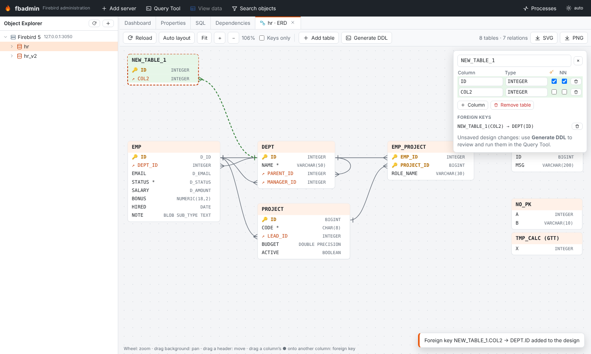
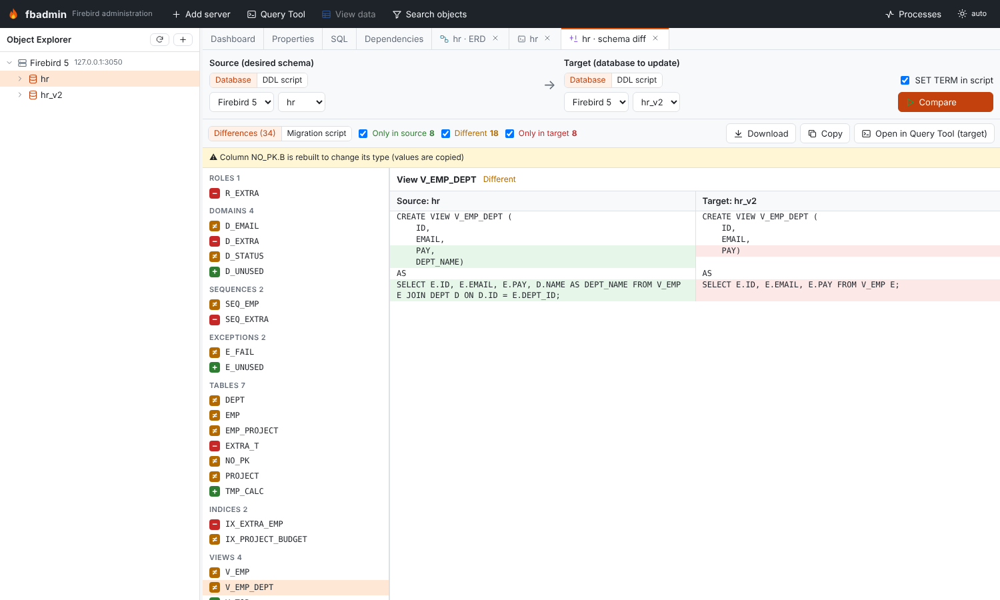
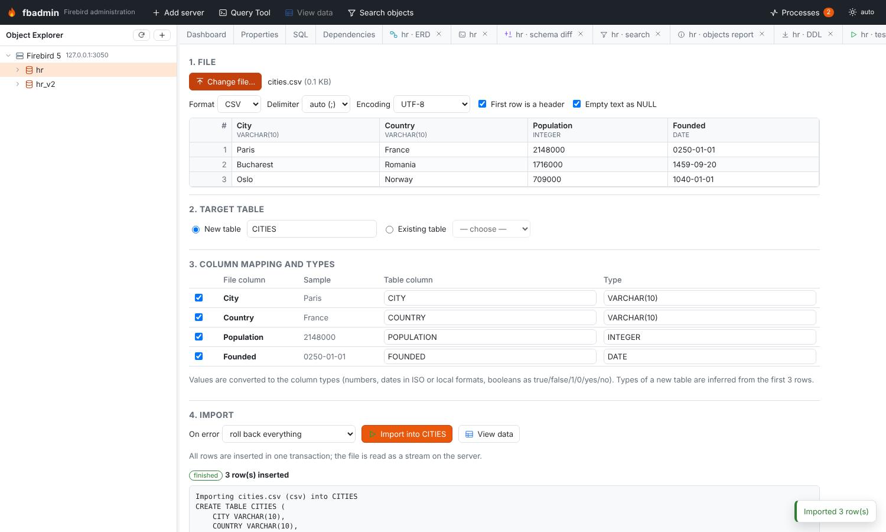
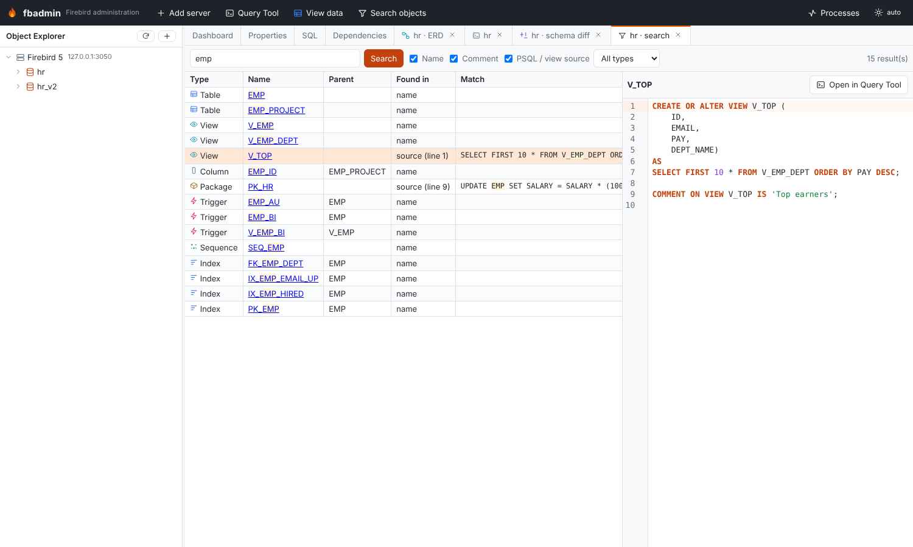

# Schema tools

Milestone 0.6 adds tools that work on a whole database. Open them from the context menu of a
database in the Object Explorer (section **Schema tools**), from the context menu of a table, or
with **Search objects** in the top bar.

| Tool | Where | Backend |
|---|---|---|
| Full DDL extract | database → *Extract DDL (full script)* | `GET /api/servers/{sid}/databases/{db}/schema/extract` |
| Schema diff | database → *Schema diff…* | `POST /api/schema/diff` |
| ERD | database / Tables folder → *ERD diagram*, table → *Show in ERD* | `GET …/schema/erd` |
| Import wizard | database / Tables folder / table → *Import data…* | `POST /api/schema/uploads`, `…/preview`, `POST …/schema/import` |
| Export | database / table / view → *Export data…* | `GET` or `POST …/schema/export` |
| Copy data | database → *Copy data to another database…*, table → *Copy to another database…* | `POST /api/schema/copy` |
| Search objects | top bar, database → *Search objects…* | `GET …/schema/search` |
| Test data generator | database / table → *Generate test data…* | `POST …/schema/generate` |
| Unused / invalid objects | database → *Unused / invalid objects* | `GET …/schema/report` |

Import, copy and the generator run as background jobs (they appear in **Processes**); their
structured result (rows inserted, failed rows and messages) is at `GET /api/schema/jobs/{id}/result`.

## Full DDL extract

Like `isql -x`, the extract writes every user object in an order that can be run into an empty
database:

1. collations, domains, legacy UDFs, sequences (with `SET GENERATOR` to the current value),
   exceptions, roles
2. tables with their columns, primary and unique keys (global temporary tables keep their
   `ON COMMIT` clause); computed columns that use other objects (e.g. a stored function) are
   created as a typed placeholder first
3. foreign keys (separately, so circular references between tables work)
4. **stubs**: every stored function and procedure with its real signature and an empty body,
   then package headers
5. views, ordered by their dependencies (views on views)
6. the real bodies (`ALTER FUNCTION` / `ALTER PROCEDURE`) and package bodies
7. the real expression of deferred computed columns, check constraints, indices (inactive ones
   stay inactive), triggers (table, view, database and DDL triggers)
8. grants (privileges to users, roles, procedures, … and role membership) and comments
   (`COMMENT ON` for every object type, columns and routine parameters)

Creating PSQL modules as stubs first and filling in the bodies afterwards is the isql technique that
breaks dependency cycles: procedures calling each other, a view selecting from a procedure that
reads another view, a package used by a function used in a computed column, and so on.

Options: `SET TERM` around PSQL (otherwise statements end with `;`, which fbadmin's script runner
also understands), grants, comments, sequence values. **Download .sql** saves the script, **Open in
Query Tool** loads it into an editor.

The extract round-trips: running it into an empty database and extracting again gives the
identical script. The tests check this with `backend/tests/complex_schema.sql`, which contains views
on views, recursive procedures, a procedure used by a view used by another procedure, a package
used by a function used in a computed column, circular foreign keys, GTTs, a user collation,
inactive indices and triggers, a database trigger, grants and comments.

Known limits: `SQL SECURITY` clauses (Firebird 4+), system privileges of roles, mappings, filters,
shadows and character set defaults are not extracted. Character sets equal to the database default
are omitted, as in the object DDL, so the target database should use the same default character set.

## Schema diff

Compare two databases, or a database and a DDL script, and get a migration script. The semantics
follow pgAdmin: **source** is the desired schema, **target** is the database to update; the script
makes the target match the source. Either side can be a registered database (on any server) or a
DDL script (upload a `.sql` file or paste it) - the script is run into a temporary database on the
server of the other side (created next to that database, with the same default character set,
and dropped afterwards).

The result lists the objects that are only in the source (created), only in the target (dropped)
or different, grouped by type, with a side-by-side DDL diff for each. Grants are compared per object.
The **Migration script** tab shows the script; **Open in Query Tool (target)** loads it into a Query
Tool on the target database to review and run it.

The migration is ordered so that it can run without dependency errors:

1. revoke privileges and remove comments that only the target has
2. *detach* PSQL that uses anything that changes: affected triggers and package bodies are dropped,
   affected procedures and functions are altered to stubs with the same signature
3. drop views that must be recreated - removed views, views whose column list changes, views that
   depend on changed tables or routines - together with every view that depends on them; then
   foreign keys, indices, constraints, columns and tables
4. create or alter domains (`ALTER DOMAIN … TYPE / SET DEFAULT / SET NOT NULL / ADD CHECK`),
   sequences, exceptions (`CREATE OR ALTER`), tables, columns (`ADD`, `ALTER … TYPE`,
   `SET/DROP DEFAULT`, `SET/DROP NOT NULL`, `COMPUTED BY`, `POSITION`), keys, new routines (stubs),
   package headers, views, then every changed or detached routine via `CREATE OR ALTER`, package
   bodies (`RECREATE PACKAGE BODY`), check constraints, indices, triggers
5. drop removed routines, packages, exceptions, sequences, domains, collations and roles (last, so
   nothing uses them any more)
6. grant privileges and set comments - also again for objects that were recreated

Type changes Firebird cannot do in place (shorter `VARCHAR`, narrower numbers, incompatible types)
rebuild the column: a new column is added, the values copied with `UPDATE`, the old column dropped
and the new one renamed and moved to the old position (keys and indices of that table are
recreated). Changes that would lose data (a column switching between computed and stored, a table
switching between persistent and temporary) are listed as warnings at the top of the script.

The tests apply the migration in both directions between `complex_schema.sql` and the same schema
with `complex_schema_changes.sql` applied, and check that the diff is empty afterwards.

Not handled: changes of a collation or of the `START WITH` value of a sequence, identity column
options (reported as warnings), and computed columns whose expression uses a column that is dropped.

## ERD

The ERD shows the tables of a database with their columns (🔑 primary key, ↗ foreign key, `*` not
null) and the foreign keys between them (crow's foot at the referencing table). It is plain SVG:

- automatic layered layout: referenced tables to the left, referencing tables to the right, tables
  without relations in a grid; **Auto layout** re-runs it, positions you drag are remembered per
  database (in the browser)
- mouse wheel zooms around the pointer, dragging the background pans, dragging a table header moves
  the table, **Fit** shows everything, **Keys only** hides other columns
- **SVG** and **PNG** export the whole diagram (colors of the current theme)

Designing: **Add table** creates a table (edit its name, columns, types, primary key and NOT NULL in
the side panel); existing tables can get new columns; drag the ● handle at the right of a column onto
the referenced column of another table to add a foreign key (a new column takes the referenced
type). **Generate DDL** opens the `CREATE TABLE` / `ALTER TABLE ADD` / `ADD CONSTRAINT … FOREIGN KEY`
statements in the Query Tool, where you review and run them.

## Import and export

The import wizard reads **CSV**, **JSON** and **XLSX** files:

1. the file is uploaded as the raw request body and streamed to disk on the server
   (`<data dir>/uploads`), so file size is not limited by memory; it is removed after the import
2. a preview shows the first rows with the detected delimiter (CSV), sheets (XLSX) and a type
   inferred for every column from the first 2000 rows (integer, numeric, double, date, timestamp,
   time, boolean, varchar with headroom, or text blob)
3. import into a **new table** (column names and types are editable) or append to an **existing
   table** (columns are matched by name; any file column can be mapped to any table column or skipped;
   optionally delete existing rows first)
4. values are converted to the column types: numbers, decimals (rounded to the scale), booleans
   (true/false/1/0/yes/no), dates and timestamps (ISO, `dd.mm.yyyy`, `mm/dd/yyyy`, …), JSON objects and
   arrays into text; empty strings can become NULL

All rows are inserted with a prepared statement in **one transaction**. On error the import either
rolls back everything (default) or skips the bad rows and reports them (row number and message).
JSON can be an array of objects, an array of arrays (first row = header), `{"data": [...]}` or
NDJSON; large arrays are parsed incrementally.

**Export** writes a table, a view or the result of a query as CSV (delimiter, header), JSON (array
of objects), XLSX or SQL `INSERT` statements (with a configurable table name). Rows are fetched in
batches on a dedicated connection into a spooled temporary file (memory, then disk), the connection
is closed and the file is streamed to the browser; table exports are plain links, so the browser
saves them directly. XLSX uses `openpyxl` (write-only mode) on the server.

## Copy data between databases

Copy one or more tables between two registered databases, on the same or different servers. Tables
are ordered so that referenced tables are copied first. Missing tables can be created in the target
(columns, primary/unique keys, the domains and user collations they use; foreign keys and indices
are added after the data, triggers and checks are not copied). Rows are read with one cursor and
inserted in batches, each batch committed; the job log shows `TABLE: n / total rows`. Identity
columns are restarted after the copied values, `GENERATED ALWAYS` identities are written with
`OVERRIDING SYSTEM VALUE` on Firebird 4+. Optionally the target rows are deleted first.

## Search objects

Search a database by **name**, **comment** or **PSQL / view source** (procedures, functions,
package headers and bodies, triggers, views, domain checks, index expressions, exception messages),
optionally limited to one object type. Columns are found by name or comment. Matches in a source
show the line and a snippet. Clicking a result selects the object in the Object Explorer (packaged
routines select their package, columns select the column of their table or view) and shows its DDL
next to the results.

## Test data generator

Insert N random rows into a table, as a job. Values follow the column type (lengths, precision and
scale) and domain, and:

- NOT NULL columns always get a value, nullable ones get NULL with a configurable ratio
- simple CHECK constraints of the table and the domain are honoured: comparisons (`>`, `>=`, `<`,
  `<=`, `=`), `BETWEEN`, `IN (…)` and `LIKE '%@%'` (e-mail addresses)
- foreign key columns get values sampled from the parent table (composite keys as tuples)
- primary and unique keys stay unique: numbers continue after the current maximum, texts get a suffix,
  composite keys are checked against existing rows
- column names give realistic text (names, e-mails, cities, phone numbers, codes)
- computed and identity columns are left to the server

Per column the generator can be changed to NULL, a fixed value, one of a list, a number range, a
sequence or "do not set". A seed makes runs repeatable. Rows that still violate a constraint (for
example a complex CHECK) are skipped and reported.

## Unused or invalid objects report

- procedures, functions and triggers with `RDB$VALID_BLR = 0` (need recompiling)
- invalid package bodies (for example after the package header changed) and packages without a body
- inactive indices and inactive triggers
- unused domains (no column, parameter or PSQL variable uses them)
- unused exceptions and sequences (no dependencies; identity sequences are excluded)
- tables without a primary key

Every entry links to the object in the Object Explorer.

## Code

- backend: `backend/fbadmin/schema/` - `model.py` (schema snapshot shared by extract and diff),
  `extract.py`, `diff.py`, `dataio.py` (uploads, readers, type inference and conversion, import,
  export), `copydata.py`, `generator.py`, `search.py`, `report.py`; API in
  `backend/fbadmin/api/schema.py`
- frontend: `frontend/src/features/schema/` (one tab kind per tool, menus and the top bar button are
  registered in `index.tsx`)
- tests: `backend/tests/test_schema_tools.py`, schemas `complex_schema.sql` and
  `complex_schema_changes.sql`
