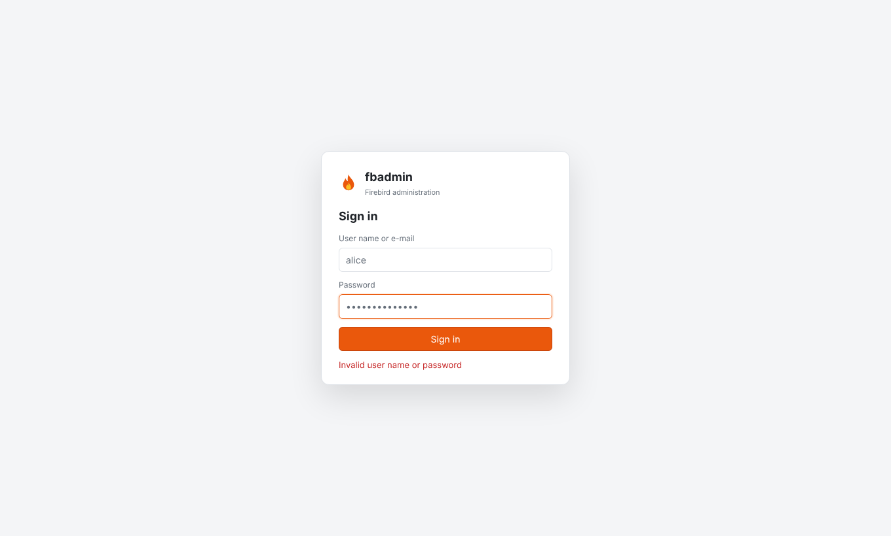
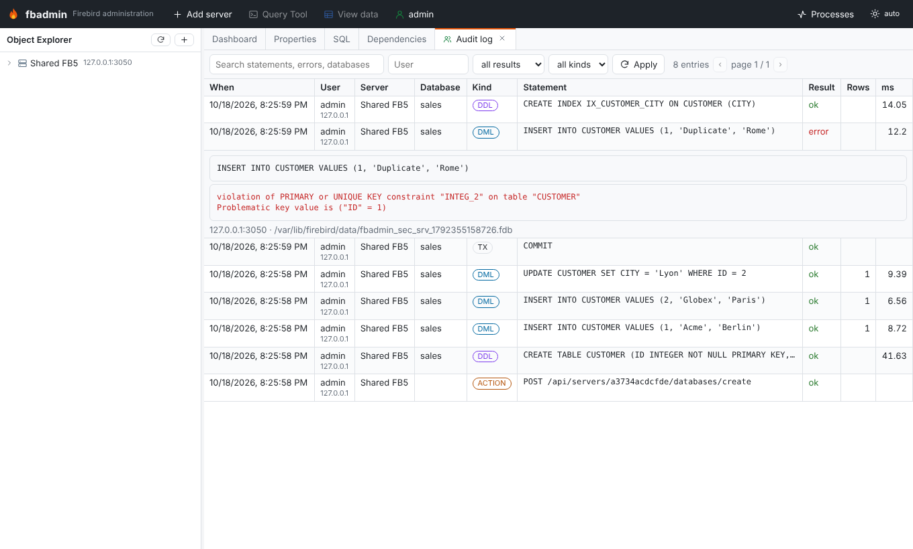
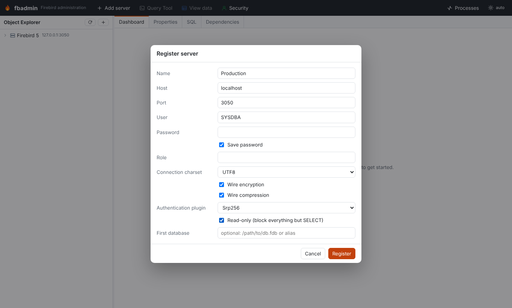
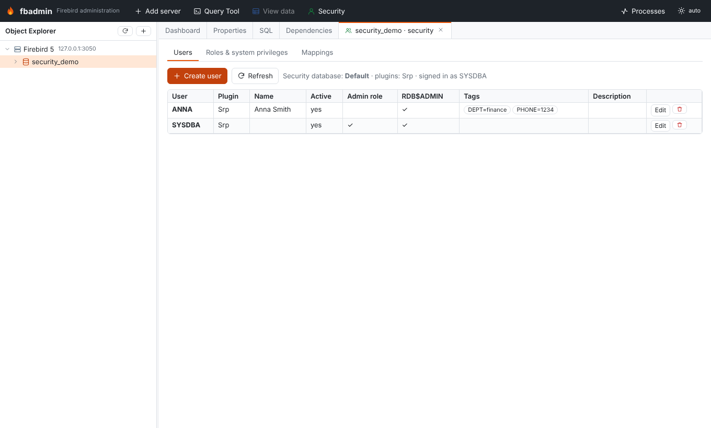

# Security and server mode

fbadmin has two modes:

| | Desktop mode (default) | Server mode (`--server-mode`) |
|---|---|---|
| Users | one local user, no login | fbadmin accounts (admin / user) |
| Server list | `~/.fbadmin/servers.json` | per user `users/<id>/servers.json` + admin-managed `shared_servers.json` |
| Saved Firebird passwords | plain text, or encrypted after you set a master password | always encrypted, per-user key |
| Audit log | off (`FBADMIN_AUDIT=1` turns it on) | on |
| CSRF | cross-site requests refused (`Sec-Fetch-Site` / `Origin`) | plus a per-session token (`X-CSRF-Token`) |

Desktop mode works as before. It binds to `127.0.0.1` and has no login. Do not expose it on a
network. Use server mode for that.



## Running in server mode

```bash
pip install 'firebird-admin[ldap]'            # the [ldap] extra is only needed for LDAP logins
export FBADMIN_SERVER_MODE=1           # or: fbadmin --server-mode
export FBADMIN_DATA_DIR=/var/lib/fbadmin
fbadmin --host 0.0.0.0 --port 5050 --no-browser
```

On the first visit, fbadmin asks you to create the initial administrator. To create it without
the web form (for containers, for example), set `FBADMIN_ADMIN_EMAIL` (or `FBADMIN_ADMIN_USERNAME`)
and `FBADMIN_ADMIN_PASSWORD`. The account is created at startup if no user exists yet.

If the data directory already contains a desktop `servers.json`, the first administrator
inherits it. The file is moved to `users/1/servers.json`, and the saved passwords are encrypted
the first time that administrator logs in.

### Users and roles

* **admin**: manages fbadmin users (top bar → user menu → *Manage users*), shared servers and the
  *Audit log*.
* **user**: has their own server list and sees the shared servers.

Each user has their own connections, Query Tool sessions and background jobs. One user cannot
reach another user's session IDs.

**Shared servers.** When an admin ticks *Shared with all fbadmin users* in the server dialog, every
user sees that registration. Only admins can change it. Passwords are never shared: each user
enters their own Firebird password, which stays in memory or is saved encrypted in that user's own
file.

### Sessions, cookies and CSRF

* The session cookie `fbadmin_session` is `HttpOnly`, `SameSite=Lax` and `Secure` over HTTPS
  (`FBADMIN_COOKIE_SECURE=auto|true|false`).
* Sessions live in memory. Restarting fbadmin logs everybody out and locks every vault. Defaults:
  8 h lifetime (`FBADMIN_SESSION_LIFETIME`) and 1 h idle timeout (`FBADMIN_SESSION_IDLE`), in
  seconds.
* CSRF uses a double-submit token. The `fbadmin_csrf` cookie, which is readable by the page and
  `SameSite=Strict`, must be echoed in the `X-CSRF-Token` header of every POST/PUT/DELETE, and it
  must match the session. Requests a browser marks as cross-site are refused in both modes.
* Every response carries `X-Frame-Options: DENY`, `X-Content-Type-Options: nosniff` and
  `Referrer-Policy: same-origin`.

### Rate and size limits (server mode)

| Variable | Default | Meaning |
|---|---|---|
| `FBADMIN_LOGIN_RATE` | `5/300` | failed logins per client IP and per user name in 300 s; then HTTP 429 with `Retry-After` |
| `FBADMIN_RATE_LIMIT` | `1200/60` | API requests per user per minute (`0` disables) |
| `FBADMIN_MAX_REQUEST_SIZE` | `16777216` | maximum request body in bytes (HTTP 413) |

Password verification takes the same time whether or not the user name exists.

## Authentication backends

Choose the backends with `FBADMIN_AUTH_SOURCES`, a comma-separated list (default `internal`):
`internal`, `ldap`, `oidc`, `proxy`. Accounts for external backends are created on first login
with the role `user` (set `FBADMIN_AUTO_CREATE_USERS=0` to require an admin to create them first).
A user name belongs to a single backend.

You can also put the settings in a JSON file: `FBADMIN_AUTH_CONFIG`, by default
`<data_dir>/auth.json`. It uses the variable names in lower case, without the `FBADMIN_` prefix,
plus the sections shown below. Environment variables override the file.

### Internal

Passwords are hashed with Argon2id (m=19 MiB, t=2, p=1). If `argon2-cffi` is missing, scrypt is
used instead. Passwords need at least 8 characters.

### LDAP (`pip install 'firebird-admin[ldap]'`)

```bash
FBADMIN_AUTH_SOURCES=internal,ldap
FBADMIN_LDAP_URL=ldaps://ldap.example.org
# a) simple bind with a DN template
FBADMIN_LDAP_USER_DN_TEMPLATE="uid={username},ou=people,dc=example,dc=org"
# b) or search + bind
FBADMIN_LDAP_BASE_DN="dc=example,dc=org"
FBADMIN_LDAP_SEARCH_FILTER="(uid={username})"        # or (sAMAccountName={username}) for AD
FBADMIN_LDAP_BIND_DN="cn=fbadmin,ou=services,dc=example,dc=org"
FBADMIN_LDAP_BIND_PASSWORD=...
# optional
FBADMIN_LDAP_START_TLS=1
FBADMIN_LDAP_EMAIL_ATTRIBUTE=mail
FBADMIN_LDAP_ADMIN_GROUP="cn=dba,ou=groups,dc=example,dc=org"   # members become fbadmin admins
```

User names are escaped for DNs and filters. An empty password is always rejected, because it
would otherwise be an anonymous bind.

### OAuth2 / OpenID Connect

fbadmin uses the authorization code flow with PKCE. For OIDC it reads the endpoints from the
issuer's discovery document. The identity comes from the provider's *userinfo* endpoint, called
over TLS with the access token. Register this redirect URI with the provider:

```
https://fbadmin.example.org/api/auth/oidc/<name>/callback
```

Set `FBADMIN_PUBLIC_URL=https://fbadmin.example.org` when fbadmin cannot work out its own public
URL, for example behind a proxy.

```json
{
  "server_mode": true,
  "auth_sources": "internal,oidc",
  "oidc": [
    {"name": "google", "client_id": "...", "client_secret": "...", "allowed_domains": ["example.org"]},
    {"name": "github", "client_id": "...", "client_secret": "...", "admin_users": ["octocat"]},
    {"name": "keycloak", "issuer": "https://sso.example.org/realms/main", "client_id": "fbadmin",
     "client_secret": "...", "admin_groups": ["fbadmin-admins"]},
    {"name": "entra", "issuer": "https://login.microsoftonline.com/<tenant-id>/v2.0",
     "client_id": "...", "client_secret": "..."}
  ]
}
```

The presets `google`, `github`, `keycloak` and `entra` fill in endpoints, scopes and the claim used
as the user name:

* GitHub is plain OAuth2. Its user name is the `login` claim.
* Entra ID uses `preferred_username`.
* Every other provider uses `email`.

Override these with `username_claim`, `email_claim`, `groups_claim`, `scope`, or the three
`*_endpoint` keys. `admin_groups` and `admin_users` decide who becomes an admin.
`allowed_domains` limits sign-in to verified e-mail addresses in those domains. The same list can
be passed as JSON in `FBADMIN_OIDC_PROVIDERS`.

### Reverse-proxy header

Use this when an authenticating proxy (oauth2-proxy, Authelia, mod_auth_openidc, ...) sits in
front of fbadmin:

```bash
FBADMIN_AUTH_SOURCES=proxy
FBADMIN_TRUSTED_PROXIES=10.0.0.5/32          # only these peers may set the header
FBADMIN_PROXY_HEADER=X-Forwarded-User        # default
FBADMIN_PROXY_ADMIN_GROUPS=dba               # optional, matched against X-Forwarded-Groups
```

fbadmin trusts the header only when the TCP peer is in `FBADMIN_TRUSTED_PROXIES`, which defaults
to localhost. Make sure clients cannot reach fbadmin directly.

## Master password: encrypted saved passwords

Saved Firebird passwords are encrypted with **AES-256-GCM** using a random 256-bit data key, and
each value is bound to its server ID. The data key is stored wrapped (AES-GCM) under a key derived
from the master password with **Argon2id**. Changing the master password only re-wraps the data
key. In `servers.json`, an encrypted value looks like `"password": "fbenc:v1:..."`.

* **Desktop mode.** Encryption is optional. Open the user menu, choose *Set master password*, and
  every plaintext password is encrypted at once (migration). The wrapped key is kept in
  `master_key.json`. After a restart, saved passwords are locked: the first connection that needs
  one asks for the master password, and the API answers `401 master_password_required`. You can
  lock again, change the master password, or remove it, which decrypts the passwords back to
  plain text.
* **Server mode.** Encryption is always on. For internal and LDAP users, the key is derived from
  the login password and unlocked at login, so there is no extra prompt. Changing your fbadmin
  password re-wraps it. Users who sign in with OIDC or the proxy set a separate master password
  the first time they save a password. Keys stay in memory only while the user has a session.
* **Forgotten password.** *Reset* forgets every encrypted saved password, which then has to be
  typed again. When an admin sets a new password for a user, that user's saved passwords are
  forgotten too, because the old key cannot be recovered without the old password.

## Read-only servers

Tick *Read-only* in the server dialog to stop accidental changes in production:

1. Every connection fbadmin opens to that server (object explorer, dialogs and Query Tool) uses
   **read-only transactions**. Firebird itself then rejects DML, DDL, GRANTs, and writes hidden in
   procedures or `EXECUTE BLOCK`. Query Tool sessions cannot switch to read-write.
2. Requests are checked before they reach Firebird. Scripts may contain only queries
   (`SELECT`/`WITH`/`EXECUTE PROCEDURE`/`EXECUTE BLOCK` plus session commands). Grid edits, drops,
   create, drop and restore of databases, sweeps, user, role and mapping changes, and other
   state-changing endpoints are refused with `403 {"code": "read_only"}`.

Sequences (`NEXT VALUE FOR`) are non-transactional in Firebird, so a read-only server can still
increment them.

## Audit log

When auditing is on (server mode, or `FBADMIN_AUDIT=1`), fbadmin records every executed non-query
statement in `<data_dir>/fbadmin.db` (SQLite), whether it succeeded or failed. This covers the
Query Tool, the create/alter dialogs, grid edits, drops, COMMIT/ROLLBACK of manual transactions,
maintenance actions, and Firebird user, role and mapping changes. Each entry stores who, when, the
client IP, the server and database, the statement, the result or error, the affected rows and the
duration. `SELECT`s are not logged. Passwords in `CREATE/ALTER USER ... PASSWORD '...'` are
replaced by `***`. Admins can browse and filter the log under user menu → *Audit log*. The API is
`GET /api/admin/audit?q=&username=&success=&category=`.



## Firebird connection options

The server dialog has these per-server options:

* **Wire encryption.** This was already available.
* **Wire compression.** zlib, Firebird 3+. fbadmin ships a small fix for the pure-Python driver,
  which otherwise fails on compressed connections. See `security/wirecompat.py`.
* **Authentication plugin.** `Srp256` (the default), `Srp` or `Legacy_Auth`. `Legacy_Auth` needs
  `pip install 'firebird-admin[legacy-auth]'`.



## Firebird security management

* **Users, roles & mappings** (right-click a database). This works through SQL in that database's
  security database (`MON$SEC_DATABASE` shows *Default*, *Self* or *Other*), so databases with
  their own security database are managed separately:
  * Users: `CREATE/ALTER/DROP USER`, `USING PLUGIN`, `TAGS (...)`, `GRANT/REVOKE ADMIN ROLE`, and
    `RDB$ADMIN` in this database. The list shows the plugin and tags (`SEC$USER_ATTRIBUTES`).
  * Roles: `CREATE ROLE … SET SYSTEM PRIVILEGES TO …`, `ALTER ROLE … SET/DROP SYSTEM PRIVILEGES`
    (Firebird 4+), and grants with `DEFAULT` and `WITH ADMIN OPTION`. The
    `RDB$ROLES.RDB$SYSTEM_PRIVILEGES` bitmask is decoded per server version.
  * Mappings: local (`RDB$AUTH_MAPPING`) and global (`SEC$GLOBAL_AUTH_MAPPING`) mappings using
    `PLUGIN` (for example `Win_Sspi` trusted authentication), `ANY PLUGIN`, `SERVERWIDE`, `MAPPING`
    or `*`, from users, groups or predefined groups, to a user or a role. Comments on mappings need
    Firebird 5.
  * *Preview SQL* shows the statements before they run.
* **Firebird users (Services API)** (right-click a server). This is gsec-style user management.
  It needs no database connection, and it can target the security database used by a given
  database.



## Running behind HTTPS

You can terminate TLS in fbadmin itself:

```bash
fbadmin --server-mode --host 0.0.0.0 --port 8443 --ssl-certfile cert.pem --ssl-keyfile key.pem
```

The more common setup is a reverse proxy (nginx, Caddy, Traefik) in front of fbadmin, which
listens on localhost only:

```nginx
server {
    listen 443 ssl http2;
    server_name fbadmin.example.org;
    ssl_certificate     /etc/letsencrypt/live/fbadmin.example.org/fullchain.pem;
    ssl_certificate_key /etc/letsencrypt/live/fbadmin.example.org/privkey.pem;
    add_header Strict-Transport-Security "max-age=31536000" always;
    client_max_body_size 16m;
    location / {
        proxy_pass http://127.0.0.1:5050;
        proxy_set_header Host $host;
        proxy_set_header X-Forwarded-For $proxy_add_x_forwarded_for;
        proxy_set_header X-Forwarded-Proto $scheme;
        proxy_read_timeout 3600s;   # long queries, backups
    }
}
```

```bash
fbadmin --server-mode --host 127.0.0.1 --port 5050 --proxy-headers --forwarded-allow-ips 127.0.0.1
```

`--proxy-headers` makes fbadmin trust `X-Forwarded-Proto` and `X-Forwarded-For` from the proxy.
fbadmin then knows the request came in over HTTPS (so cookies get `Secure`) and logs the real
client IP. Behind a proxy that terminates TLS, you can also set `FBADMIN_COOKIE_SECURE=true`.

## Checklist for a shared deployment

* Run in server mode with HTTPS, on a dedicated data directory owned by the service user. fbadmin
  writes its files with mode 0600.
* Prefer LDAP or OIDC. Keep at least one internal admin for emergencies.
* Mark production servers as read-only, and share them so users enter their own Firebird
  credentials.
* Back up `<data_dir>`. Without the users' passwords, the saved passwords cannot be decrypted.
