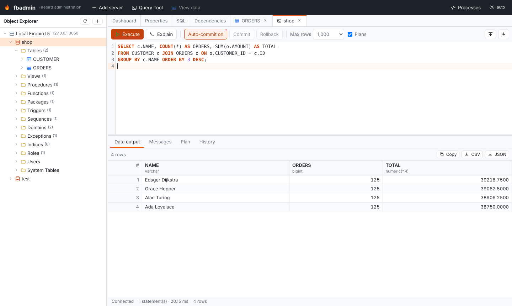

# fbadmin

**A pgAdmin-style web administration and development tool for [Firebird SQL](https://firebirdsql.org)**
(3.0, 4.0 and 5.0).

fbadmin gives Firebird a modern, browser-based admin UI: an object explorer, DDL
extraction, a query tool with plans and transactions, an editable data grid, live
monitoring and backup/restore. It runs as a local app (in your browser or in its own
desktop window), or as a container next to your server.



## Install

=== "pip"

    ```bash
    pip install fbadmin
    fbadmin            # opens http://localhost:5050
    ```

=== "Docker"

    ```bash
    docker run -p 127.0.0.1:5050:5050 -v fbadmin:/data ghcr.io/mariuz/fbadmin
    ```

=== "Desktop app"

    Download the installer for Windows (MSI or zip), macOS (dmg) or Linux (AppImage,
    deb, rpm) from the [GitHub releases](https://github.com/mariuz/fbadmin/releases).

See [Getting started](getting-started.md) for details.

## Where to go next

- [User guide](user-guide/index.md): the object explorer, the [Query Tool](QUERY_TOOL.md),
  the data grid, monitoring and maintenance.
- [Administration](admin/index.md): configuration, logging, limits, Docker and Kubernetes.
- [Privacy](PRIVACY.md): fbadmin sends no telemetry, ever.
- [Development](DEVELOPMENT.md): running the tests (unit, fuzz, end-to-end) and contributing.
