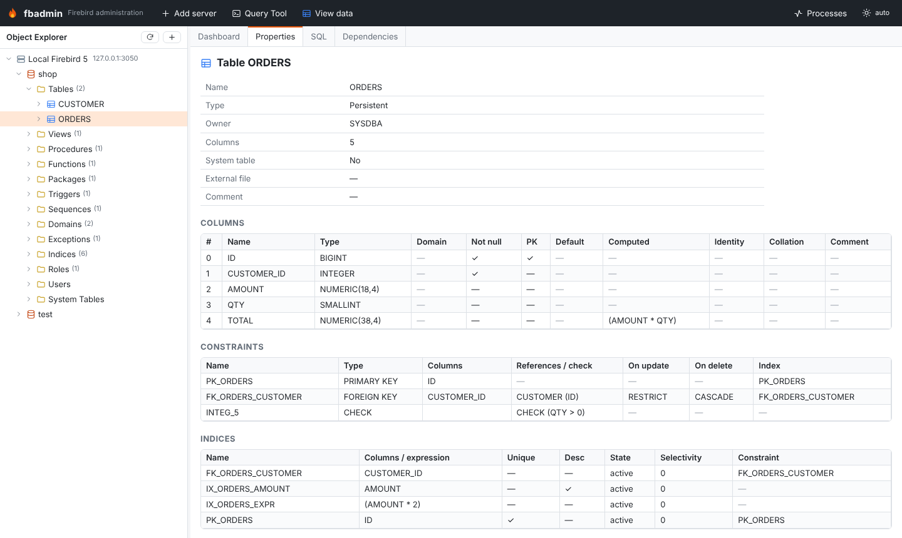
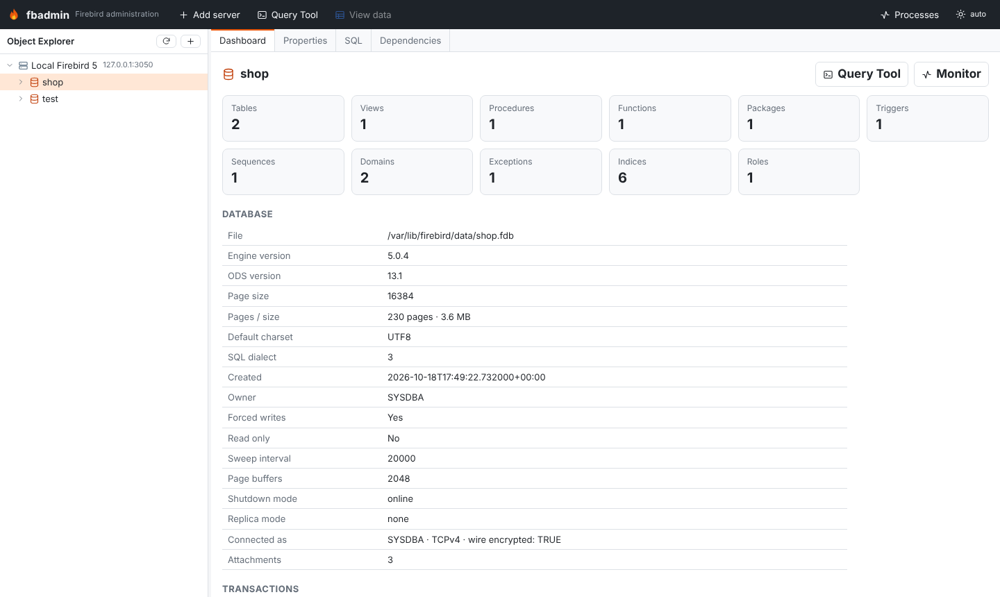

# Object explorer

## Servers and databases

**Add server** registers a Firebird server: host, port, user, password, optional role,
connection character set and wire encryption. Tick **Save password** to keep it in the
data directory; otherwise fbadmin asks for it once per session.

Under a server, right-click to **register** an existing database (by path or alias),
**create** a new one (page size, default character set) or open the **server log** and
server information. Dropping a database asks for confirmation.

## Browsing objects

Expanding a database shows a folder per object type with the number of objects:
tables, views, procedures, functions, packages, triggers, sequences, domains,
exceptions, indices, roles, users and system tables. Objects load lazily; tables and
views can be expanded further to their columns (key icon = primary key).

Selecting an object fills the fixed tabs:

- **Properties**: columns (type, domain, identity, computed, collation, default,
  nullability), constraints (primary/unique/foreign keys with rules, checks), indices
  (selectivity, expression, partial), triggers, parameters and comments.
- **SQL**: re-creatable DDL of the object. **Open in Query Tool** copies it to an editor.
  The DDL is round-trip tested: extracted, replayed into an empty database and extracted
  again on every CI run, also with randomly generated schemas.
- **Dependencies**: "depends on" and "used by" (from `RDB$DEPENDENCIES`); click a name
  to jump to it.

### Very large schemas

fbadmin stays responsive with tens of thousands of objects (tested with 20,000 tables):

- The folder counts are `COUNT(*)` queries, so expanding a database takes a fraction of a second
  even when it has tens of thousands of tables.
- A folder with more than 400 objects renders only the rows on screen, plus a margin, while you
  scroll. Expanded tables stay expanded when they scroll out of view and back, screen readers
  still hear the position ("row 12,345 of 20,000"), and **Home**/**End** jump to the real first and
  last rows.
- In the Query Tool, autocompletion of a schema with more than 20,000 columns gets the table names
  first, then the columns of the tables the query mentions, when you type them.

Loading a folder's list still fetches every name. With the pure-Python driver and wire encryption
(the default), that takes about 3 s for 20,000 tables: the driver decrypts the data in Python. The
native driver (see [Database drivers](../DRIVERS.md)) is much faster.

## Database dashboard

Selecting a database shows its header (ODS, page size, size, dialect, character set,
forced writes, sweep interval, replica mode), the transaction counters (OIT, OAT, OST,
next transaction, with a warning when the gap grows) and the number of objects per type.

